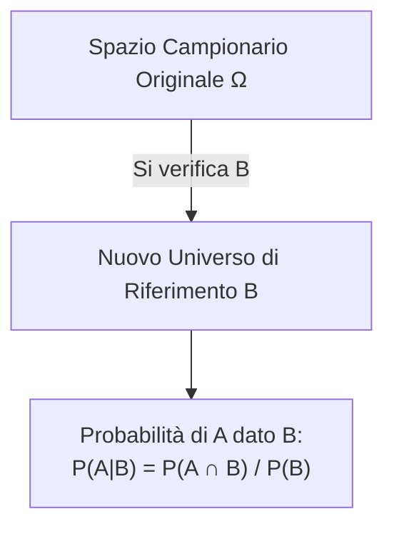
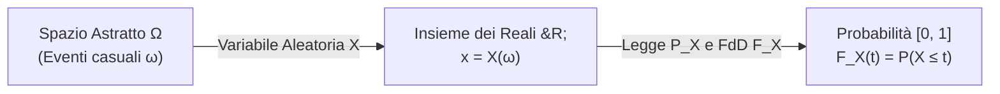

# Lezione 02 - Probabilità Condizionata, Formula delle Probabilità Totali, Teorema di Bayes e Variabili Aleatorie Discrete

---
**Docente:** Vito Onofrio Crismale (`vitoonofrio.crismale@uniba.it`)  
**Testi di riferimento:**
- Ross, *Statistica per l'Ingegneria e le Scienze*
- Baldi, *Calcolo delle Probabilità e Statistica*

---

## 1. Probabilità Condizionata

> [!abstract] L'Idea in Parole Semplici
> La probabilità di un evento può dipendere dal verificarsi o meno di un altro evento. Spesso acquisire una nuova informazione (sapere che l'evento $B$ è già accaduto) restringe lo spazio delle possibilità da tutto $\Omega$ al solo sottoinsieme $B$, modificando le probabilità degli eventi rimanenti.

### Definizione Formale

Sia $(\Omega, \mathcal{F}, P)$ uno spazio di probabilità e siano $A, B \in \mathcal{F}$ con $P(B) > 0$.  
Si definisce **probabilità condizionata** di $A$ dato $B$ la quantità:

$$\boxed{P(A \mid B) = \frac{P(A \cap B)}{P(B)}}$$

> [!note] Osservazione Geometrica e Interpretazione
> Se $B$ si è verificato, è come se lo spazio campionario $\Omega$ si riducesse a $B$.  
> Nel caso di spazi finiti equiprobabili:
> $$P(A \mid B) = \frac{\frac{|A \cap B|}{|\Omega|}}{\frac{|B|}{|\Omega|}} = \frac{|A \cap B|}{|B|} = \frac{\text{casi favorevoli ad } A \cap B}{\text{casi possibili entro } B}$$

### Formula delle Probabilità Congiunte (Regola del Prodotto)

Dalla definizione di probabilità condizionata si ottiene direttamente:

$$\boxed{P(A \cap B) = P(A \mid B) \cdot P(B)}$$

> [!tip] Utilità fondamentale
> Oltre a modificare la valutazione di $A$ dato il verificarsi di $B$, la probabilità condizionata è estremamente utile per calcolare la probabilità di eventi congiunti $A \cap B$ che a priori sarebbero difficili da calcolare direttamente.

---

### Esempio Introduttivo: Estrazione senza reimbussolamento

**Problema:**  
Sia data un'urna contenente $b$ palline bianche ed $n$ palline nere (totale $b + n$). Si effettuano estrazioni consecutive **senza rimessa**.  
Qual è la probabilità che la seconda pallina estratta sia bianca?

**Definizione degli eventi:**
- $A = \{\text{la II estratta è bianca}\}$
- $B = \{\text{la I estratta è bianca}\}$
- $B^c = \{\text{la I estratta è nera}\}$

Sappiamo che $B$ e $B^c$ formano una partizione dell'universo. Pertanto:
$$P(A) = P(A \cap B) + P(A \cap B^c) = P(A \mid B)P(B) + P(A \mid B^c)P(B^c)$$

Sostituendo i valori numerici:
- $P(B) = \frac{b}{b+n}$
- $P(A \mid B) = \frac{b-1}{b+n-1}$ (rimangono $b-1$ bianche su $b+n-1$ totali)
- $P(B^c) = \frac{n}{b+n}$
- $P(A \mid B^c) = \frac{b}{b+n-1}$ (rimangono tutte le $b$ bianche su $b+n-1$ totali)

Calcoliamo:
$$P(A) = \left( \frac{b-1}{b+n-1} \right) \left( \frac{b}{b+n} \right) + \left( \frac{b}{b+n-1} \right) \left( \frac{n}{b+n} \right)$$
$$P(A) = \frac{b(b-1) + bn}{(b+n)(b+n-1)} = \frac{b(b - 1 + n)}{(b+n)(b+n-1)} = \frac{b}{b+n}$$

> [!important] Risultato Notevole
> La probabilità che la seconda estratta sia bianca è esattamente uguale alla probabilità della prima estratta $\frac{b}{b+n}$. L'ordine di estrazione, senza conoscere l'esito della prima, non altera la probabilità marginale!

---

## 2. Formula delle Probabilità Totali

Cosa accade se gli eventi condizionanti sono più di due (non solo $B$ e $B^c$)?

> [!note] Teorema (Formula delle Probabilità Totali)
> Sia $(\Omega, \mathcal{F}, P)$ uno spazio di probabilità e sia $\{B_i\}_{i=1}^n$ una famiglia di eventi che costituisce una **partizione** di $\Omega$, ovvero:
> 1. $\bigcup_{i=1}^n B_i = \Omega$
> 2. $B_i \cap B_j = \emptyset \quad \forall i \neq j$ (a due a due disgiunti)
> 3. $P(B_i) > 0 \quad \forall i = 1, \dots, n$
> 
> Allora, per ogni evento $A \in \mathcal{F}$:
> $$\boxed{P(A) = \sum_{i=1}^n P(A \cap B_i) = \sum_{i=1}^n P(A \mid B_i) P(B_i)}$$

### Dimostrazione Passo-Passo
1. Poiché $\bigcup_{i=1}^n B_i = \Omega$, possiamo decomporre $A$:
   $$A = A \cap \Omega = A \cap \left( \bigcup_{i=1}^n B_i \right) = \bigcup_{i=1}^n (A \cap B_i)$$
2. Poiché i $\{B_i\}$ sono a due a due disgiunti, anche gli insiemi $\{A \cap B_i\}$ sono tra loro disgiunti:
   $$(A \cap B_i) \cap (A \cap B_j) = A \cap (B_i \cap B_j) = A \cap \emptyset = \emptyset \quad (i \neq j)$$
3. Per l'assioma di additivita (A3):
   $$P(A) = P\left( \bigcup_{i=1}^n (A \cap B_i) \right) = \sum_{i=1}^n P(A \cap B_i)$$
4. Applicando la regola del prodotto $P(A \cap B_i) = P(A \mid B_i) P(B_i)$ a ogni termine della somma:
   $$P(A) = \sum_{i=1}^n P(A \mid B_i) P(B_i) \quad \blacksquare$$

---

### Esempio: La scelta del mezzo di trasporto
Per raggiungere una destinazione posso usare indifferentemente il treno ($T$), l'aereo ($A$) o l'autobus ($B$).  
I tre mezzi sono scelti con la stessa probabilità: $P(T) = P(A) = P(B) = \frac{1}{3}$.  
Le probabilità di arrivare in ritardo ($R$) con ciascun mezzo sono:
- $P(R \mid A) = 10\% = 0.10$
- $P(R \mid T) = 20\% = 0.20$
- $P(R \mid B) = 17\% = 0.17$

Qual è la probabilità complessiva di fare ritardo?
$$P(R) = P(R \mid A)P(A) + P(R \mid T)P(T) + P(R \mid B)P(B)$$
$$P(R) = (0.10) \cdot \frac{1}{3} + (0.20) \cdot \frac{1}{3} + (0.17) \cdot \frac{1}{3} = \frac{0.10 + 0.20 + 0.17}{3} = \frac{0.47}{3} \approx 0.1567 \quad (15.67\%)$$

---

## 3. Teorema di Bayes (Probabilità delle Cause / a Posteriori)

> [!abstract] Il Problema Inverso
> Supponiamo che una persona ci veda arrivare con **ritardo** ($R$ si è verificato).  
> Ci chiediamo: *qual è il mezzo più probabile con cui abbiamo viaggiato?*  
> Cioè vogliamo invertire il condizionamento e calcolare $P(A \mid R)$, $P(T \mid R)$ o $P(B \mid R)$.

### Enunciato del Teorema di Bayes

Nelle stesse ipotesi della formula delle probabilità totali (partizione $\{B_i\}_{i=1}^n$ con $P(B_i) > 0$ e $P(A) > 0$), per ogni $i = 1, \dots, n$:

$$\boxed{P(B_i \mid A) = \frac{P(A \cap B_i)}{P(A)} = \frac{P(A \mid B_i) P(B_i)}{\sum_{k=1}^n P(A \mid B_k) P(B_k)}}$$

- **$P(B_i)$**: probabilità **a priori** della causa $B_i$.
- **$P(A \mid B_i)$**: **verosimiglianza** dell'evento $A$ data la causa $B_i$.
- **$P(B_i \mid A)$**: probabilità **a posteriori** della causa $B_i$ dopo aver osservato l'effetto $A$.
- **$P(A)$**: probabilità totale (fattore di normalizzazione).

---

### Esempio 1: Il Paradosso delle Carte (o Scatola di Bertrand)

**Problema:**  
Un'urna contiene 2 carte:
- Carta 1: ha un lato bianco ($b$) e un lato nero ($n$).
- Carta 2: ha entrambi i lati neri ($2n$).

Si estrae una carta a caso e si osserva un lato: la faccia mostrata è **nera** ($A$).  
Qual è la probabilità che anche il secondo lato sia nero (ossia che si tratti della carta con due lati neri)?

**Formalizzazione:**
- $B$: viene estratta la carta $\{1b, 1n\}$ $\implies P(B) = \frac{1}{2}$
- $B^c$: viene estratta la carta $\{2n\}$ $\implies P(B^c) = \frac{1}{2}$
- $A$: "la faccia visibile è nera"
  - $P(A \mid B) = \frac{1}{2}$ (la carta ha 1 lato nero su 2)
  - $P(A \mid B^c) = 1$ (la carta ha entrambi i lati neri)

Vogliamo calcolare $P(B^c \mid A)$:
$$P(B^c \mid A) = \frac{P(A \mid B^c) P(B^c)}{P(A \mid B)P(B) + P(A \mid B^c)P(B^c)} = \frac{1 \cdot \frac{1}{2}}{\left(\frac{1}{2} \cdot \frac{1}{2}\right) + \left(1 \cdot \frac{1}{2}\right)} = \frac{\frac{1}{2}}{\frac{1}{4} + \frac{1}{2}} = \frac{\frac{1}{2}}{\frac{3}{4}} = \frac{1}{2} \cdot \frac{4}{3} = \frac{2}{3}$$

> [!danger] Trabocchetto d'Esame
> L'errore intuitivo comune è pensare che, vedendo un lato nero, la carta possa essere con probabilità $50\%$ la prima o la seconda. In realtà, la carta bicolore ha solo una faccia nera che può essere mostrata, mentre la carta con due facce nere ne ha due! Ciascuna faccia nera ha la stessa probabilità di uscire, quindi in 2 casi su 3 la carta scelta è quella tutta nera.

---

### Esempio 2: Controllo Qualità e Pezzi Difettosi (Viti da 3 Macchine)

**Problema:**  
Un'azienda produce viti usando 3 macchine: $M_1, M_2, M_3$.
- Quote di produzione: $P(M_1) = \frac{1}{2} = 0.5$, $P(M_2) = \frac{3}{10} = 0.3$, $P(M_3) = \frac{1}{5} = 0.2$.
- Tasso di pezzi difettosi ($D$):
  - $P(D \mid M_3) = 0.05$ (5%)
- Una vite scelta a caso risulta **difettosa** ($D$). Qual è la probabilità che provenga dalla macchina $M_2$, cioè $P(M_2 \mid D)$?

Applicando Bayes:
$$P(M_2 \mid D) = \frac{P(D \mid M_2) P(M_2)}{P(D)} = \frac{P(D \mid M_2) P(M_2)}{\sum_{i=1}^3 P(D \mid M_i) P(M_i)}$$

---

## 4. Indipendenza Stocastica

### Definizione

Due eventi $A, B \in \mathcal{F}$ (con $P(A)>0, P(B)>0$) si dicono **stocasticamente indipendenti** se:

$$\boxed{P(A \mid B) = P(A)}$$

Significa che il verificarsi di $B$ **non fornisce alcuna informazione** sul verificarsi di $A$.

### Condizione Equivalente di Moltiplicazione

$$A, B \text{ indipendenti} \iff \boxed{P(A \cap B) = P(A) \cdot P(B)}$$

**Dimostrazione dell'equivalenza:**
- $(\implies)$ Se $P(A \mid B) = P(A)$, allora:
  $$P(A \cap B) = P(A \mid B) P(B) = P(A) P(B)$$
- $(\impliedby)$ Se $P(A \cap B) = P(A) P(B)$, allora:
  $$P(A \mid B) = \frac{P(A \cap B)}{P(B)} = \frac{P(A) P(B)}{P(B)} = P(A) \quad \blacksquare$$

> [!important] Vantaggio della seconda formulazione
> La formula simmetrica $P(A \cap B) = P(A)P(B)$ è valida anche se $P(A)=0$ oppure $P(B)=0$, e si estende naturalmente a collezioni di più eventi.

---

### Esempio Notevole: Il Paradosso dei Compleanni

**Problema:**  
In una stanza ci sono $n$ persone ($n \le 365$). Assumendo che ogni anno abbia 365 giorni equiprobabili e che le date di nascita siano tra loro indipendenti, qual è la probabilità $P(A)$ che **almeno due persone compiano gli anni lo stesso giorno**?

**Risoluzione col Complementare:**
Consideriamo l'evento complementare:  
$A^c = \{\text{tutte le } n \text{ persone sono nate in giorni diversi}\}$.

1. **Numero di configurazioni possibili:**  
   Ogni persona può essere nata in uno qualsiasi dei 365 giorni:
   $$|\Omega| = 365^n$$
2. **Numero di configurazioni favorevoli ad $A^c$:**  
   La prima persona ha 365 scelte, la seconda 364, ..., l'$n$-esima $(365 - n + 1)$:
   $$|A^c| = 365 \cdot 364 \cdot \dots \cdot (365 - n + 1) = \frac{365!}{(365 - n)!}$$
3. **Probabilità:**
   $$P(A^c) = \frac{|A^c|}{|\Omega|} = \frac{365!}{(365 - n)! \cdot 365^n}$$
   $$\boxed{P(A) = 1 - P(A^c) = 1 - \frac{365!}{(365 - n)! \cdot 365^n}}$$

**Valori Notevoli:**
- Se $n = 23$: $P(A) \approx 0.507$ (oltre il **50%** di probabilità con sole 23 persone!)
- Se $n = 64$: $P(A) \approx 0.997$ (quasi la certezza!)
- Se $n > 365$: $P(A) = 1$ per il principio dei cassetti (pigeonhole principle).

---

## 5. Schema Prove Ripetute Indipendenti (Successo / Insuccesso)

Consideriamo un esperimento che prevede $n$ prove indipendenti e identiche. Ad ogni singola prova può verificarsi:
- **Successo ($S$):** con probabilità $p$
- **Insuccesso ($I$):** con probabilità $1 - p$

Qual è la probabilità di ottenere esattamente $k$ successi su $n$ prove ($k = 0, 1, \dots, n$)?

1. **Una sequenza specifica:**  
   Fissiamo una determinata sequenza con $k$ successi e $n-k$ insuccessi, ad esempio i successi nelle prime $k$ prove:
   $$\underbrace{(S, S, \dots, S)}_{k \text{ volte}}, \underbrace{(I, I, \dots, I)}_{n-k \text{ volte}}$$
   Per l'indipendenza delle singole prove:
   $$P(S, \dots, S, I, \dots, I) = P(S)^k \cdot P(I)^{n-k} = p^k (1-p)^{n-k}$$
2. **Tutte le possibili sequenze:**  
   Ogni altra sequenza contenente $k$ successi ha la medesima probabilità $p^k(1-p)^{n-k}$. Tali sequenze formano eventi disgiunti.
3. **Quante sequenze esistono?**  
   Corrisponde al numero di modi distinti di posizionare $k$ successi in $n$ posizioni, ovvero i sottoinsiemi di cardinalità $k$ su $n$ elementi:
   $$\binom{n}{k} = \frac{n!}{k!(n-k)!}$$

Sommando su tutte le sequenze disgiunte si ottiene la celebre formula:

$$\boxed{P(\text{esattamente } k \text{ successi}) = \binom{n}{k} p^k (1-p)^{n-k}}$$

---

## 6. Variabili Aleatorie e Legge di Distribuzione

> [!abstract] Perché introdurre le Variabili Aleatorie?
> Spesso gli esiti di un esperimento casuale $\Omega$ sono di natura qualitativa (es. Testa/Croce, funzionante/rotto, sequenze di caratteri). Per poter applicare gli strumenti del calcolo e dell'analisi matematica, associamo ad ogni esito $\omega \in \Omega$ un numero reale $X(\omega) \in \mathbb{R}$.

### Definizione Formale di Variabile Aleatoria (v.a.)

Sia $(\Omega, \mathcal{F}, P)$ uno spazio di probabilità.  
Una funzione $X: \Omega \to \mathbb{R}$ si dice **variabile aleatoria** se per ogni $t \in \mathbb{R}$ il sottoinsieme:

$$\{\omega \in \Omega \mid X(\omega) \le t\} \in \mathcal{F}$$

> [!note] Notazione Compatta
> Scriveremo comunemente:
> $$\{X \le t\} := \{\omega \in \Omega \mid X(\omega) \le t\}$$
> Più in generale, per qualunque insieme boreliano $B \subseteq \mathbb{R}$:
> $$\{X \in B\} := \{\omega \in \Omega \mid X(\omega) \in B\} \in \mathcal{F}$$

### Distribuzione (o Legge) di una Variabile Aleatoria

Si definisce **legge** o **distribuzione** di $X$ la misura di probabilità $P_X: \mathcal{P}(\mathbb{R}) \to [0, 1]$ definita da:

$$\boxed{P_X(B) = P(X \in B)}$$

> [!important] Trasferimento da $\Omega$ a $\mathbb{R}$
> $P_X$ è una vera e propria misura di probabilità su $\mathbb{R}$. La variabile aleatoria $X$ trasferisce il calcolo delle probabilità dall'insieme "astratto" $\Omega$ ai numeri reali $\mathbb{R}$, permettendoci di usare l'algebra e l'analisi.

### Identità di Variabili vs Identità in Legge

> [!warning] Concetto Chiave d'Esame
> - Se $X = Y$ (identiche puntualmente come funzioni su $\Omega$), allora banalmente $P_X = P_Y$.
> - **Il viceversa NON è vero!** Si possono avere due variabili aleatorie completamente diverse ($X \neq Y$), aventi però la stessa identica legge di probabilità ($P_X = P_Y$).

#### Controesempio Classico:
Lanciamo un dado equilibrato a 6 facce, $\Omega = \{1, 2, 3, 4, 5, 6\}$ con $P(i) = \frac{1}{6}$.
Definiamo due v.a.:
$$X = \begin{cases} 0 & \text{se la faccia è dispari } \{1, 3, 5\} \\ 1 & \text{se la faccia è pari } \{2, 4, 6\} \end{cases}$$
$$Y = \begin{cases} 0 & \text{se la faccia è } \le 3 \ \{1, 2, 3\} \\ 1 & \text{se la faccia è } \ge 4 \ \{4, 5, 6\} \end{cases}$$

- Valutiamo su un esito specifico, ad esempio l'esito $\omega = 2$:
  $$X(2) = 1, \quad Y(2) = 0 \implies X \neq Y$$
- Tuttavia, calcoliamo le probabilità:
  $$P(X = 0) = \frac{3}{6} = \frac{1}{2}, \quad P(X = 1) = \frac{3}{6} = \frac{1}{2}$$
  $$P(Y = 0) = \frac{3}{6} = \frac{1}{2}, \quad P(Y = 1) = \frac{3}{6} = \frac{1}{2}$$
  Le due leggi coincidono su ogni sottoinsieme $B \subseteq \mathbb{R}$: **$P_X = P_Y$ pur essendo $X \neq Y$!**

---

## 7. Funzione di Distribuzione (o di Ripartizione)

### Definizione

Data una v.a. $X$, la sua **funzione di distribuzione** (FdD) o **funzione di ripartizione** è l'applicazione $F_X: \mathbb{R} \to [0, 1]$ definita da:

$$\boxed{F_X(t) = P(X \le t) = P_X\big((-\infty, t]\big)}$$

> [!note] Equivalenza
> Conoscere la legge $P_X$ di $X$ equivale perfettamente a conoscere la sua funzione di distribuzione $F_X$.

### Proprietà Fondamentali di $F_X(t)$

| # | Proprietà | Formula Matematica | Spiegazione |
|---|---|---|---|
| **1** | Codominio | $\forall t \in \mathbb{R}, \quad 0 \le F_X(t) \le 1$ | È una probabilità |
| **2** | Monotonia | $x \le y \implies F_X(x) \le F_X(y)$ | È debolmente crescente |
| **3** | Limiti all'infinito | $\lim_{t \to -\infty} F_X(t) = 0, \quad \lim_{t \to +\infty} F_X(t) = 1$ | Copre l'intero asse reale |
| **4** | Probabilità degli intervalli | $\forall a < b, \quad P(a < X \le b) = F_X(b) - F_X(a)$ | Calcolo su intervalli semiaperti |
| **5** | Continuità da destra | $\forall t \in \mathbb{R}, \quad \lim_{x \to t^+} F_X(x) = F_X(t)$ | Continua da destra ovunque |

### Probabilità puntuale tramite salto di $F_X$:
Dalla proprietà 4 segue che:
$$P(X = t) = \lim_{x \to t^+} F_X(x) - \lim_{x \to t^-} F_X(x) = F_X(t) - F_X(t^-)$$
- Se $F_X$ è continua in $t$, allora $P(X = t) = 0$.
- Se $X$ assume valori discreti, $F_X(t)$ presenta dei **salti** pari alla probabilità di quel punto.

---

### Vettori Aleatori e Indipendenza di Variabili Aleatorie

Un vettore aleatorio $n$-dimensionale è una funzione $X = (X_1, \dots, X_n): \Omega \to \mathbb{R}^n$.  
La sua funzione di distribuzione congiunta è:
$$F_X(t_1, \dots, t_n) = P(X_1 \le t_1, \dots, X_n \le t_n)$$

> [!note] Indipendenza di Variabili Aleatorie
> Le variabili aleatorie $X_1, \dots, X_n$ si dicono **stocasticamente indipendenti** se e solo se per ogni $t_1, \dots, t_n \in \mathbb{R}$:
> $$\boxed{F_X(t_1, \dots, t_n) = F_{X_1}(t_1) \cdot F_{X_2}(t_2) \dots F_{X_n}(t_n)}$$
> O equivalentemente:
> $$P(X_1 \in I_1, \dots, X_n \in I_n) = \prod_{i=1}^n P(X_i \in I_i)$$

---

## 8. Variabili Aleatorie Discrete e Funzione di Probabilità

### Definizione

Una v.a. $X: \Omega \to \mathbb{R}$ si dice **discreta** se il suo codominio (supporto) $X(\Omega) = \text{cod}(X)$ è un insieme **finito** o **infinito numerabile**.

Per ogni $t \in \text{cod}(X)$, il singoletto $\{X = t\}$ è un evento ben definito. Si definisce la **funzione di probabilità** (o densità discreta / massa di probabilità):

$$p_X: \text{cod}(X) \to [0, 1], \quad \boxed{p_X(t) = P(X = t)}$$

### Proprietà di normalizzazione:
$$\sum_{t \in \text{cod}(X)} p_X(t) = 1$$

Per ogni sottoinsieme $B \subseteq \mathbb{R}$:
$$P(X \in B) = \sum_{t \in B \cap \text{cod}(X)} p_X(t)$$
Dunque per una v.a. discreta la funzione di probabilità determina univocamente l'intera legge della variabile. Inoltre la sua funzione di distribuzione $F_X(t)$ è una funzione **costante a tratti (a gradini)**.

---

## 9. Le Famiglie Notabili di Variabili Aleatorie Discrete

### 1. Variabile Aleatoria di Bernoulli: $X \sim \text{Ber}(p)$
Descrive un singolo esperimento che può avere solo due esiti: successo ($1$) o insuccesso ($0$).
- **Parametro:** $p \in (0, 1)$, dove $p = P(E)$
- **Supporto:** $\{0, 1\}$
- **Formula:**
  $$X = \mathbf{1}_E = \begin{cases} 1 & \text{se } \omega \in E \\ 0 & \text{se } \omega \notin E \end{cases}$$
  $$P(X = 1) = p, \quad P(X = 0) = 1 - p$$

---

### 2. Variabile Aleatoria Binomiale: $X \sim \text{Bin}(n, p)$
Conta il numero di successi ottenuti in $n$ prove indipendenti di Bernoulli di parametro $p$.
- **Parametri:** $n \in \mathbb{N} \setminus \{0\}$, $p \in (0, 1)$
- **Supporto:** $\{0, 1, 2, \dots, n\}$
- **Formula:**
  $$\boxed{P(X = k) = \binom{n}{k} p^k (1-p)^{n-k}, \quad k = 0, 1, \dots, n}$$

> [!note] Proprietà di Decomposizione e Somma di Binomiali Indipendenti
> Se $X_1, \dots, X_n \sim \text{Ber}(p)$ sono indipendenti, allora:
> $$X = \sum_{i=1}^n X_i \sim \text{Bin}(n, p)$$
> Più in generale, se $X \sim \text{Bin}(n_1, p)$ e $Y \sim \text{Bin}(n_2, p)$ sono **indipendenti con lo stesso parametro $p$**, allora:
> $$\boxed{X + Y \sim \text{Bin}(n_1 + n_2, p)}$$

---

### 3. Variabile Aleatoria Geometrica: $X \sim \text{Geo}(p)$
Conta il **numero del tentativo** in cui si verifica il primo successo in una serie di prove di Bernoulli indipendenti con parametro $p$.
- **Parametro:** $p \in (0, 1)$
- **Supporto:** $\{1, 2, 3, \dots\} = \mathbb{N} \setminus \{0\}$
- **Formula:**
  $$\boxed{P(X = k) = p(1-p)^{k-1}, \quad k = 1, 2, 3, \dots}$$

#### Verifica della Normalizzazione:
$$\sum_{k=1}^\infty P(X = k) = \sum_{k=1}^\infty p(1-p)^{k-1} = p \sum_{j=0}^\infty (1-p)^j = p \cdot \frac{1}{1 - (1-p)} = \frac{p}{p} = 1 \quad \blacksquare$$
*(usando la serie geometrica $\sum_{j=0}^\infty q^j = \frac{1}{1-q}$ valida per $|q| < 1$)*

#### Proprietà di Mancanza di Memoria (Assenza di Memoria)
La distribuzione geometrica è l'unica distribuzione discreta che gode dell'assenza di memoria:

$$\boxed{P(X > n+m \mid X > m) = P(X > n), \quad \forall n, m \in \mathbb{N} \setminus \{0\}}$$

**Dimostrazione:**
1. Notiamo che $\{X > n\}$ significa che i primi $n$ tentativi sono stati tutti insuccessi:
   $$P(X > n) = \sum_{k=n+1}^\infty p(1-p)^{k-1} = (1-p)^n$$
2. Calcoliamo la probabilità condizionata:
   $$P(X > n+m \mid X > m) = \frac{P(X > n+m \cap X > m)}{P(X > m)} = \frac{P(X > n+m)}{P(X > m)} = \frac{(1-p)^{n+m}}{(1-p)^m} = (1-p)^n = P(X > n) \quad \blacksquare$$

---

### 4. Variabile Aleatoria di Poisson: $X \sim \text{Poisson}(\lambda)$
Modella il numero di eventi rari che si verificano in un intervallo continuo (es. chiamate a un call center, accessi a un server, difetti di fabbricazione).
- **Parametro:** $\lambda > 0$ (tasso medio di accadimento)
- **Supporto:** $\{0, 1, 2, \dots\} = \mathbb{N} \cup \{0\}$
- **Formula:**
  $$\boxed{P(X = k) = e^{-\lambda} \frac{\lambda^k}{k!}, \quad k = 0, 1, 2, \dots}$$

#### Teorema del Limite di Poisson (Legge dei Casi Rari)
Se $n \to \infty$ e $p_n \to 0$ con $n p_n \to \lambda$, allora la distribuzione binomiale $\text{Bin}(n, p_n)$ converge alla distribuzione di Poisson di parametro $\lambda$:
$$\lim_{n \to \infty} \binom{n}{k} \left(\frac{\lambda}{n}\right)^k \left(1 - \frac{\lambda}{n}\right)^{n-k} = e^{-\lambda} \frac{\lambda^k}{k!}$$

#### Proprietà della Somma di Poisson Indipendenti
Se $X \sim \text{Poisson}(\lambda_1)$ e $Y \sim \text{Poisson}(\lambda_2)$ sono **indipendenti**, allora:
$$\boxed{X + Y \sim \text{Poisson}(\lambda_1 + \lambda_2)}$$

**Dimostrazione:**
Sia $k \ge 0$:
$$P(X+Y = k) = \sum_{j=0}^k P(X=j, Y=k-j) \stackrel{\text{indip.}}{=} \sum_{j=0}^k P(X=j) P(Y=k-j)$$
$$= \sum_{j=0}^k \left( e^{-\lambda_1} \frac{\lambda_1^j}{j!} \right) \left( e^{-\lambda_2} \frac{\lambda_2^{k-j}}{(k-j)!} \right) = \frac{e^{-(\lambda_1 + \lambda_2)}}{k!} \sum_{j=0}^k \frac{k!}{j!(k-j)!} \lambda_1^j \lambda_2^{k-j}$$
$$= \frac{e^{-(\lambda_1 + \lambda_2)}}{k!} \underbrace{\sum_{j=0}^k \binom{k}{j} \lambda_1^j \lambda_2^{k-j}}_{= (\lambda_1 + \lambda_2)^k \text{ per il binomio di Newton}} = e^{-(\lambda_1 + \lambda_2)} \frac{(\lambda_1 + \lambda_2)^k}{k!} \quad \blacksquare$$

---

## 10. Esercizi Svolti Passo-Passo

### Esercizio 1: Estrazione di due palline da un'urna
**Testo:** Un'urna contiene 15 palline di cui 5 bianche, 5 rosse e 5 nere. Si estraggono 2 palline.
Calcolare la probabilità dell'evento $A = \{\text{le 2 palline sono dello stesso colore}\}$:
- **Caso a:** Estrazione contemporanea (senza reimbussolamento).
- **Caso b:** Estrazione con reimbussolamento.

**Svolgimento Caso a (senza reimbussolamento):**
L'evento $A = A_B \cup A_R \cup A_N$ è unione disgiunta dei tre colori:
$$P(A_B) = \frac{\binom{5}{2}}{\binom{15}{2}} = \frac{\frac{5 \cdot 4}{2}}{\frac{15 \cdot 14}{2}} = \frac{10}{105} = \frac{2}{21}$$
Per simmetria:
$$P(A) = 3 \cdot \frac{2}{21} = \frac{6}{21} = \frac{2}{7} \approx 0.2857$$

**Svolgimento Caso b (con reimbussolamento):**
Lo spazio campionario è $|\Omega| = 15^2 = 225$. Per ciascun colore favorevole ci sono $5^2 = 25$ esiti:
$$P(A_B) = \frac{5^2}{15^2} = \left(\frac{1}{3}\right)^2 = \frac{1}{9}$$
$$P(A) = 3 \cdot \frac{1}{9} = \frac{1}{3} \approx 0.3333$$

---

### Esercizio 2: Overbooking Aereo (Applicazione Binomiale)
**Testo:** Un volo ha $20$ posti disponibili. Per massimizzare i ricavi, la compagnia vende $22$ biglietti. Ciascun passeggero ha probabilità $p = 0.9$ di presentarsi all'imbarco indipendentemente dagli altri.  
Qual è la probabilità che si verifichi una situazione di overbooking (più di 20 persone all'imbarco)?

**Soluzione:**
Sia $Y$ la variabile aleatoria che conta il numero di persone che si presentano su 22 prenotati.
$$Y \sim \text{Bin}(22, \, 0.9)$$
L'evento overbooking corrisponde a $\{Y > 20\} = \{Y = 21\} \cup \{Y = 22\}$:
$$P(Y > 20) = P(Y = 21) + P(Y = 22)$$
$$P(Y = 21) = \binom{22}{21} (0.9)^{21} (0.1)^1 = 22 \cdot (0.9)^{21} \cdot 0.1$$
$$P(Y = 22) = \binom{22}{22} (0.9)^{22} (0.1)^0 = (0.9)^{22}$$
$$P(Y > 20) = (0.9)^{21} \cdot \big[ 22 \cdot 0.1 + 0.9 \big] = (0.9)^{21} \cdot [2.2 + 0.9] = 3.1 \cdot (0.9)^{21} \approx 0.339 \quad (33.9\%)$$

---

### Esercizio 3: Centralino di Operatori (Rete Dati)
**Testo:** Un server gestisce 24 postazioni di operatori. Ciascun operatore richiede una connessione attiva indipendentemente dagli altri con probabilità $p = 0.6$.  
Qual è la probabilità che ci siano almeno 20 operatori connessi contemporaneamente?

**Soluzione:**
Sia $X$ il numero di operatori attivi:
$$X \sim \text{Bin}(24, \, 0.6)$$
$$P(X \ge 20) = \sum_{i=20}^{24} P(X = i) = \sum_{i=20}^{24} \binom{24}{i} (0.6)^i (0.4)^{24-i}$$

---

### Esercizio 4: Scatole di Componenti Difettosi con Causa Incognita (Bayes + Binomiale)
**Testo:** Una scatola da 10 pezzi proviene con probabilità $P(A) = 0.3$ dalla linea di produzione $A$ e con probabilità $P(A^c) = 0.7$ dalla linea $B$.
- La linea $A$ produce pezzi difettosi con probabilità $p_A = 0.1$.
- La linea $B$ produce pezzi difettosi con probabilità $p_B = 0.17$.

Dalla scatola si osserva esattamente 1 pezzo difettoso ($X = 1$).  
Qual è la probabilità che la scatola provenga dalla linea $A$?

**Soluzione:**
Condizionatamente all'origine della scatola, il numero di difetti su 10 pezzi è binomiale:
- Se proviene da $A$: $X \mid A \sim \text{Bin}(10, \, 0.1)$
  $$P(X = 1 \mid A) = \binom{10}{1} (0.1)^1 (0.9)^9 = 10 \cdot 0.1 \cdot (0.9)^9 = (0.9)^9 \approx 0.3874$$
- Se proviene da $A^c$: $X \mid A^c \sim \text{Bin}(10, \, 0.17)$
  $$P(X = 1 \mid A^c) = \binom{10}{1} (0.17)^1 (0.83)^9 = 1.7 \cdot (0.83)^9 \approx 0.3186$$

Probabilità totale di trovare 1 difetto:
$$P(X = 1) = P(X = 1 \mid A)P(A) + P(X = 1 \mid A^c)P(A^c) = 0.3874 \cdot 0.3 + 0.3186 \cdot 0.7 \approx 0.1162 + 0.2230 = 0.3392$$

Applicando il Teorema di Bayes:
$$\boxed{P(A \mid X = 1) = \frac{P(X = 1 \mid A)P(A)}{P(X = 1)} = \frac{0.1162}{0.3392} \approx 0.3426 \quad (34.26\%)}$$

---

### Esercizio 5: Trasformazione di Poisson e FdD di $Y = \min(X, 2)$
**Testo:** Sia $X \sim \text{Poisson}(3)$. Si definisca $Y = \min(X, 2)$.
1. Determinare il supporto e la funzione di probabilità di $Y$.
2. Determinare la funzione di distribuzione $F_Y(y)$ e disegnarne il grafico a tratti.
3. Stabilire se gli eventi $\{Y = 1\}$ e $\{X \le 2\}$ sono indipendenti.

**Soluzione punto 1 (Funzione di probabilità di $Y$):**
Poiché $Y = \min(X, 2)$, il codominio di $Y$ è ristretto a $\{0, 1, 2\}$:
- Per $y = 0$: $Y = 0 \iff X = 0$:
  $$P(Y = 0) = P(X = 0) = e^{-3} \frac{3^0}{0!} = e^{-3}$$
- Per $y = 1$: $Y = 1 \iff X = 1$:
  $$P(Y = 1) = P(X = 1) = e^{-3} \frac{3^1}{1!} = 3 e^{-3}$$
- Per $y = 2$: $Y = 2 \iff X \ge 2$:
  $$P(Y = 2) = P(X \ge 2) = 1 - P(X < 2) = 1 - \big[P(X = 0) + P(X = 1)\big] = 1 - (e^{-3} + 3e^{-3}) = 1 - 4e^{-3}$$

**Soluzione punto 2 (Funzione di Distribuzione $F_Y(y)$):**
$$F_Y(y) = P(Y \le y) = \begin{cases}
0 & \text{se } y < 0 \\
e^{-3} & \text{se } 0 \le y < 1 \\
e^{-3} + 3e^{-3} = 4e^{-3} & \text{se } 1 \le y < 2 \\
1 & \text{se } y \ge 2
\end{cases}$$

**Soluzione punto 3 (Indipendenza tra $\{Y = 1\}$ e $\{X \le 2\}$):**
- Notiamo che l'evento $\{Y = 1\}$ coincide con $\{X = 1\}$.
- Poiché l'evento $\{X = 1\} \subset \{X \le 2\}$, la loro intersezione è semplicemente $\{X = 1\}$:
  $$P(\{Y = 1\} \cap \{X \le 2\}) = P(X = 1) = 3e^{-3}$$
- Il prodotto delle probabilità marginali è:
  $$P(Y = 1) \cdot P(X \le 2) = (3e^{-3}) \cdot \big[P(X=0) + P(X=1) + P(X=2)\big] = (3e^{-3}) \cdot e^{-3}\left(1 + 3 + \frac{9}{2}\right) = 3e^{-3} \cdot \left(\frac{17}{2} e^{-3}\right) \neq 3e^{-3}$$
Poiché $P(A \cap B) \neq P(A)P(B)$, **i due eventi NON sono stocasticamente indipendenti**.

---

## 11. Checkpoint & Trabocchetti d'Esame

> [!danger] Trabocchetto 1: Bayes al contrario
> Non invertire mai a intuito le condizioni! $P(A \mid B)$ misura la probabilità di osservare il sintomo $A$ dato che si ha la malattia $B$. L'orale o lo scritto chiedono quasi sempre $P(B \mid A)$, ossia la probabilità della causa dato l'effetto. Usa sempre il Teorema di Bayes.

> [!danger] Trabocchetto 2: Indipendenza vs Incompatibilità (Disgiunzione)
> - **Eventi Incompatibili (Disgiunti):** $A \cap B = \emptyset \implies P(A \cap B) = 0$. Se uno accade, l'altro NON può accadere!
> - **Eventi Indipendenti:** $P(A \cap B) = P(A)P(B) > 0$ (se $P(A), P(B) > 0$).
> Due eventi a probabilità non nulla non possono **mai** essere contemporaneamente indipendenti e incompatibili!

> [!question] La Domanda del Prof all'Orale
> **D:** *"Se due variabili aleatorie hanno la stessa funzione di ripartizione $F_X(t) = F_Y(t)$, sono necessariamente la stessa variabile?"*  
> **R:** No! Hanno la stessa legge (distribuzione di probabilità), ma possono essere funzioni completamente differenti definite su $\Omega$ (come visto nell'esempio delle facce pari/dispari del dado rispetto a $\le 3$ / $\ge 4$).