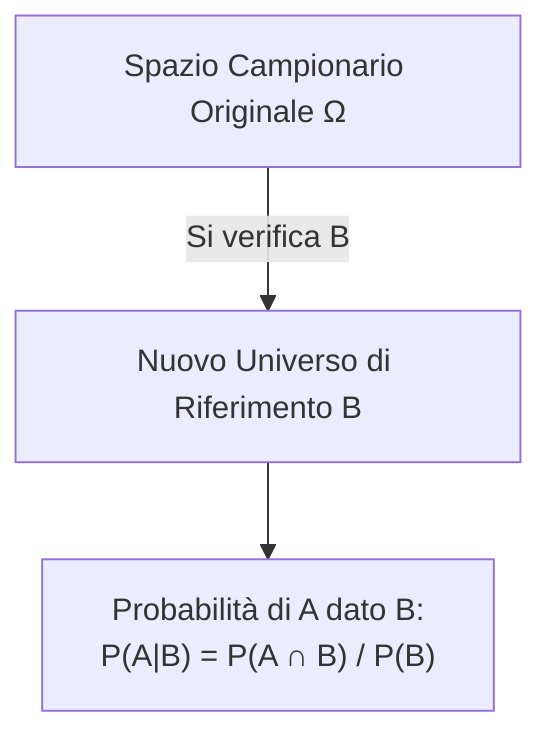

# Lezione 02 - Probabilità Condizionata, Formula delle Probabilità Totali, Teorema di Bayes ed Eventi Indipendenti

> ⬅️ **Precedente:** [[Lezione 01 - Spazi di Probabilità]] | 🏠 **Indice:** [[00 - INDICE STATISTICA]] | **Successiva:** [[Lezione 03 - Prove di Bernoulli, Variabili Aleatorie e Funzione di Ripartizione]] ➡️ | 🛠️ **Pratica:** [[Guida Pratica agli Esercizi d'Esame e Strategie Risolutive]]

---
**Docente:** Vito Onofrio Crismale (`vitoonofrio.crismale@uniba.it`)  
**Testi di riferimento:**
- Ross, *Statistica per l'Ingegneria e le Scienze*
- Baldi, *Calcolo delle Probabilità e Statistica*

---

## 1. Probabilità Condizionata

> [!abstract] L'Idea in Parole Semplici
> La probabilità di un evento può dipendere dal verificarsi o meno di un altro evento: cambia a seconda delle **informazioni** a nostra disposizione. Acquisire una nuova informazione (sapere che l'evento $B$ si è già verificato) restringe lo spazio dei campioni da tutto $\Omega$ al solo sottoinsieme $B$, modificando le probabilità degli eventi rimanenti.

### Definizione Formale

Sia $(\Omega, \mathcal{F}, P)$ uno spazio di probabilità (visto nella [[Lezione 01 - Spazi di Probabilità|Lezione 01]]) e siano $A, B \in \mathcal{F}$ tali che $P(B) > 0$.  
Si definisce **probabilità condizionata** di $A$ dato $B$ la quantità:

$$\boxed{P(A \mid B) = \frac{P(A \cap B)}{P(B)}} \tag{1}$$

> [!note] Osservazione 1: Interpretazione sullo Spazio Campionario
> Se $B$ si è verificato, è come se lo spazio dei campioni $\Omega$ diventasse $B$.  
> Ad esempio, se $|\Omega| < +\infty$ e gli eventi elementari sono **equiprobabili**, allora:
> $$P(A \mid B) = \frac{P(A \cap B)}{P(B)} = \frac{\frac{|A \cap B|}{\cancel{|\Omega|}}}{\frac{|B|}{\cancel{|\Omega|}}} = \frac{|A \cap B|}{|B|} = \frac{\text{casi favorevoli ad } A \cap B}{\text{casi possibili entro } B}$$

### Formula delle Probabilità Congiunte (Regola del Prodotto)

> [!tip] Osservazione 2: Calcolo della Probabilità Congiunta
> Oltre che per modificare la probabilità dell'evento $A$ in presenza del verificarsi di $B$, la probabilità condizionata è estremamente utile per calcolare la probabilità di **eventi congiunti** $A \cap B$ che a priori sarebbero difficili da valutare direttamente.  
> Dalla definizione (1) si ricava infatti:
> $$\boxed{\underbrace{P(A \cap B)}_{\text{CONGIUNTA}} = P(A \mid B) \cdot P(B)}$$

Inoltre, ricordando la formula di decomposizione $P(A) = P(A \cap B) + P(A \cap B^c)$ dimostrata nella [[Lezione 01 - Spazi di Probabilità|Lezione 01]], applicando la (1) ad entrambi gli addendi otteniamo:
$$\boxed{P(A) = P(A \mid B)P(B) + P(A \mid B^c)P(B^c)} \tag{2}$$

---

### Problema Iniziale: Estrazione senza Rimessa da un'Urna

**Problema:**  
Sia data un'urna contenente $n$ palline **nere** e $b$ palline **bianche** (totale $n + b$ palline). Si effettua un'estrazione consecutiva **senza rimessa** (senza reimbussolamento).  
Qual è la probabilità che la **II estratta sia bianca**?

**Svolgimento:**  
L'esito della seconda estrazione dipende dall'esito della prima estrazione. Definiamo gli eventi:
- $A = \{\text{II estratta è bianca } (b)\}$
- $B = \{\text{I estratta è bianca } (b)\}$
- $B^c = \{\text{I estratta è nera } (n)\}$

Applicando la formula (2):
$$P(A) = P(A \mid B)P(B) + P(A \mid B^c)P(B^c)$$

Sostituiamo i singoli valori:
- $P(B) = \frac{b}{n + b}$
- $P(A \mid B) = \frac{b - 1}{n + b - 1}$ *(se la prima era bianca, nell'urna restano $b - 1$ bianche su $n + b - 1$ palline totali)*
- $P(B^c) = \frac{n}{n + b}$
- $P(A \mid B^c) = \frac{b}{n + b - 1}$ *(se la prima era nera, nell'urna restano tutte le $b$ bianche su $n + b - 1$ palline totali)*

Calcoliamo:
$$P(A) = \left( \frac{b - 1}{n + b - 1} \right) \cdot \left( \frac{b}{n + b} \right) + \left( \frac{b}{n + b - 1} \right) \cdot \left( \frac{n}{n + b} \right)$$
$$P(A) = \frac{b(b - 1 + n)}{(n + b)(n + b - 1)} = \frac{b \cancel{(n + b - 1)}}{(n + b)\cancel{(n + b - 1)}} = \boxed{\frac{b}{n + b}}$$

> [!important] Risultato Notevole (Invarianza della Probabilità Marginale)
> Senza avere informazioni sull'esito della prima estrazione, la probabilità che la seconda estratta sia bianca è $\frac{b}{n+b}$, **esattamente uguale alla probabilità che la prima estratta sia bianca**!

---

## 2. Formula delle Probabilità Totali

**Problema 2:** Se gli eventi che condizionano sono **più di due** (non solo $B$ e $B^c$), cosa accade alla formula (2)?

> [!note] Proposizione (Formula delle Probabilità Totali)
> Sia $(\Omega, \mathcal{F}, P)$ uno spazio di probabilità, sia $A \in \mathcal{F}$ e sia $\{B_i\}_{i=1}^n$ una famiglia di eventi che forma una **partizione** di $\Omega$, cioè tale che:
> 1. $\bigcup_{i=1}^n B_i = \Omega$ *(esaustivi)*
> 2. $B_i \cap B_j = \emptyset \quad \text{se } i \neq j$ *(a due a due disgiunti)*
> 3. $P(B_i) > 0 \quad \forall i = 1, \dots, n$
> 
> Allora:
> $$\boxed{P(A) = \sum_{i=1}^n P(A \mid B_i) P(B_i)} \tag{3}$$

### Dimostrazione Passo-Passo
1. Poiché $\bigcup_{i=1}^n B_i = \Omega$, possiamo riscrivere $A$ intersecandolo con $\Omega$:
   $$P(A) = P(A \cap \Omega) = P\left( A \cap \left( \bigcup_{i=1}^n B_i \right) \right) = P\left( \bigcup_{i=1}^n (A \cap B_i) \right)$$
2. Poiché i $B_i$ sono a due a due disgiunti ($B_i \cap B_j = \emptyset$ per $i \neq j$), anche le intersezioni $(A \cap B_i)$ sono a due a due disgiunte. Per l'assioma di additività:
   $$= \sum_{i=1}^n P(A \cap B_i)$$
3. Applicando la regola del prodotto $P(A \cap B_i) = P(A \mid B_i)P(B_i)$ a ciascun addendo:
   $$= \sum_{i=1}^n P(A \mid B_i) P(B_i) \quad \blacksquare$$

---

### Esempio: Scelta del Mezzo di Trasporto (Aereo, Treno, Bus)

**Testo:**  
Per andare in un luogo posso usare indifferentemente l'**aereo** ($A$), il **treno** ($T$) o il **bus** ($B$), quindi $P(A) = P(T) = P(B) = \frac{1}{3}$.  
La probabilità di fare ritardo è del:
- $10\%$ con l'aereo: $P(R \mid A) = 0.10$
- $20\%$ col treno: $P(R \mid T) = 0.20$
- $17\%$ col bus: $P(R \mid B) = 0.17$

Qual è la probabilità complessiva di fare ritardo?

**Soluzione:**  
Posto $R = \{\text{ritardo}\}$, per la formula delle probabilità totali (3):
$$P(R) = P(R \mid A)P(A) + P(R \mid T)P(T) + P(R \mid B)P(B)$$
$$P(R) = (0.10)\cdot\frac{1}{3} + (0.20)\cdot\frac{1}{3} + (0.17)\cdot\frac{1}{3} = \frac{0.47}{3} \approx 0.1567 \quad (15.67\%)$$

---

## 3. Teorema di Bayes (Probabilità delle Cause)

> [!abstract] Il Problema Inverso
> Riprendiamo l'esempio precedente: supponiamo che una certa persona mi veda **arrivare con ritardo** ($R$ si è verificato!).  
> *Qual è il mezzo più probabile con cui ho viaggiato?*  
> Dobbiamo calcolare le probabilità inverse (a posteriori):
> $$P(A \mid R) = ? \qquad P(T \mid R) = ? \qquad P(B \mid R) = ?$$

### Enunciato del Teorema di Bayes

> [!note] Proposizione (Teorema di Bayes)
> Nelle stesse ipotesi della proposizione precedente (partizione $\{B_i\}_{i=1}^n$ di $\Omega$ con $P(B_i) > 0$ e $P(A) > 0$), si ha per ogni $i = 1, \dots, n$:
> $$\boxed{P(B_i \mid A) = \frac{P(A \mid B_i) P(B_i)}{P(A)} \stackrel{(3)}{=} \frac{P(A \mid B_i) P(B_i)}{\sum_{k=1}^n P(A \mid B_k) P(B_k)}} \tag{4}$$

Nell'esempio dei trasporti, una volta calcolato $P(R)$, la probabilità di aver preso l'aereo sapendo di essere arrivati in ritardo è semplicemente:
$$P(A \mid R) = \frac{P(R \mid A)P(A)}{P(R)}$$

---

### Esempio 1: Il Paradosso delle Due Carte (Urna di Bertrand)

**Testo:**  
Un'urna contiene $2$ carte:
- Una carta contiene $1$ lato bianco e $1$ lato nero ($\{1b, 1n\}$).
- L'altra carta ha entrambi i lati neri ($\{2\text{ nere}\}$).

Si estrae a caso una carta, la si poggia sul tavolo e si vede che **il lato visibile è nero**.  
Qual è la probabilità che anche la **II faccia (quella nascosta) sia nera** (cioè di aver estratto la carta con entrambe le facce nere)?

**Svolgimento:**
Definiamo gli eventi:
- $A = \{\text{vista faccia nera}\}$
- $B = \{\text{carta } 1b, 1n\} \implies P(B) = \frac{1}{2}$
- $B^c = \{\text{carta } 2\text{ nere}\} \implies P(B^c) = \frac{1}{2}$

Le probabilità condizionate di vedere un lato nero sono:
- $P(A \mid B) = \frac{1}{2}$ *(la carta bicolore ha 1 faccia nera su 2)*
- $P(A \mid B^c) = 1$ *(la carta tutta nera mostra certamente una faccia nera)*

Applicando la formula di Bayes (4) per calcolare $P(B^c \mid A)$:
$$P(B^c \mid A) \stackrel{(4)}{=} \frac{P(A \mid B^c) P(B^c)}{P(A \mid B)P(B) + P(A \mid B^c)P(B^c)} = \frac{1 \cdot \frac{1}{2}}{\frac{1}{2} \cdot \frac{1}{2} + 1 \cdot \frac{1}{2}} = \frac{\frac{1}{2}}{\frac{1}{4} + \frac{1}{2}} = \frac{\frac{1}{2}}{\frac{3}{4}} = \frac{1}{\cancel{2}} \cdot \frac{\cancel{4}^2}{3} = \boxed{\frac{2}{3}}$$

---

### Esempio 2: Produzione di Viti su 3 Macchine

**Problema:**  
In una fabbrica le viti vengono prodotte da tre macchine $M_1, M_2, M_3$.  
Sia $M_i = \text{"La vite è prodotta dalla macchina } i\text{-esima"}$ ($i \in \{1, 2, 3\}$) e sia $D = \text{"La vite è difettosa"}$.  
Conoscendo le quote di produzione:
$$P(M_1) = \frac{1}{2}, \qquad P(M_2) = \frac{3}{10}, \qquad P(M_3) = \frac{1}{5}$$
e le probabilità condizionate di difettosità $P(D \mid M_i)$ (ad es. $P(D \mid M_3) = 0.05$), si calcola la probabilità che una vite difettosa provenga dalla seconda macchina tramite Bayes:
$$P(M_2 \mid D) = \frac{P(D \mid M_2) P(M_2)}{P(D \mid M_1)P(M_1) + P(D \mid M_2)P(M_2) + P(D \mid M_3)P(M_3)}$$

---

## 4. Eventi Indipendenti

### Definizione

Sia $(\Omega, \mathcal{F}, P)$ uno spazio di probabilità e siano $A, B \in \mathcal{F}$ con $P(A), P(B) > 0$.  
Si dice che $A$ è **indipendente** da $B$ se:
$$\boxed{P(A \mid B) = P(A)} \tag{5}$$
Significa che l'evento $A$ **non è condizionato** dal verificarsi di $B$ o meno.

### Caratterizzazione Equivalente (Regola di Moltiplicazione)

> [!note] Osservazione (Simmetria dell'Indipendenza)
> Equivalentemente, $A$ è indipendente da $B$ se e solo se:
> $$\boxed{P(A \cap B) = P(A) \cdot P(B)} \tag{6}$$
> **Dimostrazione:**
> - Se vale la (5), allora dalla definizione (1) segue:
>   $$P(A \cap B) = P(A \mid B)P(B) \stackrel{(5)}{=} P(A)P(B)$$
> - Se invece vale la (6), allora:
>   $$P(A \mid B) \stackrel{(1)}{=} \frac{P(A \cap B)}{P(B)} \stackrel{(6)}{=} \frac{P(A)\cancel{P(B)}}{\cancel{P(B)}} = P(A) \quad \blacksquare$$

---

### Esempio: Il Paradosso dei Compleanni

**Problema:**  
In un gruppo di $n$ persone, qual è la probabilità $P(\text{2 compleanni condivisi})$, ossia che **almeno 2 persone compiano gli anni nello stesso giorno**?

**Svolgimento tramite l'Evento Complementare:**
1. Sia $A = \{\text{almeno 2 persone compiono gli anni lo stesso giorno}\}$.  
   Passiamo al complementare:
   $$A^c = \{\text{tutti compiono gli anni in giorni diversi}\}, \qquad P(A) = 1 - P(A^c)$$
2. **Spazio campionario $\Omega$:**  
   Ogni persona può essere nata in uno qualsiasi dei 365 giorni dell'anno:
   $$|\Omega| = \underbrace{365 \cdot 365 \cdots 365}_{n \text{ volte}} = (365)^n$$
3. **Casi favorevoli ad $A^c$ (tutti giorni diversi):**  
   La prima persona ha 365 giorni possibili, la seconda 364, la terza 363, ..., l'$n$-esima $(365 - n + 1)$:
   $$|A^c| = 365 \cdot 364 \cdot 363 \cdots (365 - n + 1) = \frac{365!}{(365 - n)!}$$
4. **Calcolo della probabilità:**
   $$\boxed{P(A) = 1 - P(A^c) = 1 - \frac{|A^c|}{|\Omega|} = 1 - \frac{365!}{(365 - n)! \cdot (365)^n}}$$

**Valori numerici notevoli visti a lezione:**
- Per **$n = 23$**: $P(A) \approx \frac{1}{2}$ (già con 23 persone c'è circa il $50\%$ di probabilità!)
- Per **$n = 64$**: $P(A) \approx 0.997$ ($99.7\%$!)
- Per **$n > 365$** (es. $n > 366$): $P(A) = 1$ (evento certo).

> [!question] Domanda Aggiuntiva del Prof a Fine Pagina
> *"Qual è invece la probabilità che almeno una delle altre persone sia nata **nello stesso MIO giorno** (una data specifica prefissata)?"*  
> **Risposta:** Questa domanda è molto diversa! Fissata la mia data di nascita, ciascuna delle altre $m$ persone ha probabilità $\frac{364}{365}$ di **non** essere nata nel mio giorno. Per indipendenza, la probabilità che almeno una sia nata nel mio stesso giorno è:
> $$P(\text{almeno 1 nel mio giorno}) = 1 - \left(\frac{364}{365}\right)^m$$
> (Per raggiungere il $50\%$ qui servono ben $m = 253$ persone, contro le sole $23$ del paradosso dei compleanni, perché nel paradosso dei compleanni si confrontano **tutte le coppie possibili** $\binom{n}{2}$, non solo le coppie con me!).

---

## 5. Esercizio Svolto: Estrazione di 2 Palline da un'Urna (Senza vs Con Rimessa)

**Problema:**  
Un'urna contiene $15$ palline: $5$ Bianche ($B$), $5$ Rosse ($R$) e $5$ Nere ($N$).  
Si pescano $2$ palline. Calcolare la probabilità dell'evento:
$$A = \text{"Le 2 palline pescate sono dello stesso colore"}$$
nel caso di:
- **a)** Estrazione in blocco / senza rimessa.
- **b)** Estrazione con rimessa (reimbussolamento).

### Svolgimento Caso a) — Senza Rimessa (Sottoinsiemi)
- Lo spazio campionario $\Omega$ è l'insieme dei sottoinsiemi di $2$ palline estratti dall'insieme di $15$ palline:
  $$|\Omega| = \binom{15}{2} = \frac{15 \cdot 14}{2} = 105$$
- Decomponiamo l'evento $A$ nei tre colori:
  $$A = A_B \cup A_R \cup A_N \quad \text{dove } A_B = \text{"Le 2 palline pescate sono bianche"}$$
  Gli eventi $A_B, A_R, A_N$ sono **a due a due disgiunti**, quindi:
  $$P(A) = P(A_B) + P(A_R) + P(A_N)$$
- Per ciascun colore ci sono $\binom{5}{2} = \frac{5 \cdot 4}{2} = 10$ coppie favorevoli:
  $$P(A_B) = \frac{|A_B|}{|\Omega|} = \frac{\binom{5}{2}}{\binom{15}{2}} = \frac{10}{105} = \frac{2}{21}$$
- Sommando i tre colori equiprobabili:
  $$\boxed{P(A) = 3 \cdot \frac{2}{21} = \frac{6}{21} = \frac{2}{7} \approx 0.2857}$$

### Svolgimento Caso b) — Con Rimessa (Coppie Ordinate)
- Lo spazio campionario è l'insieme delle coppie ordinate $\Omega = \{(\omega_1, \omega_2) \mid \omega_i \in \{1, \dots, 15\}\}$ con probabilità uniforme:
  $$|\Omega| = 15^2 = 225$$
- Per il colore bianco:
  $$P(A_B) = \frac{|A_B|}{|\Omega|} = \frac{5^2}{15^2} = \left(\frac{1}{3}\right)^2 = \frac{1}{9}$$
- Sommando sui tre colori disgiunti:
  $$\boxed{P(A) = 3 \cdot \frac{1}{9} = \frac{1}{3} \approx 0.3333}$$

---

## 🔗 Link Interni (Mappa del Grafo)

- 🏠 **Indice Generale:** [[00 - INDICE STATISTICA]]
- ⬅️ **Lezione Precedente:** [[Lezione 01 - Spazi di Probabilità]]
- ➡️ **Lezione Successiva (Schema di Bernoulli, Variabili Aleatorie e FdR):** [[Lezione 03 - Prove di Bernoulli, Variabili Aleatorie e Funzione di Ripartizione]]
- 🔗 **Applicazione di Bayes alla Binomiale (Scatola da 10 pezzi):** [[Lezione 04 - Variabili Aleatorie Discrete, Bernoulli e Binomiale]]
- 🔗 **Applicazione della Condizionata alla Mancanza di Memoria:** [[Lezione 05 - Variabile Aleatoria Geometrica e Mancanza di Memoria]]
- 🛠️ **Strategie d'Esame:** [[Guida Pratica agli Esercizi d'Esame e Strategie Risolutive]]
