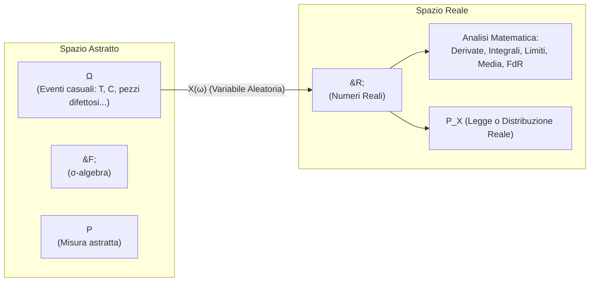

# Lezione 03 - Prove di Bernoulli, Variabili Aleatorie e Funzione di Ripartizione

> ⬅️ **Precedente:** [[Lezione 02 - Probabilità Condizionata, Teorema di Bayes ed Eventi Indipendenti]] | 🏠 **Indice:** [[00 - INDICE STATISTICA]] | **Successiva:** [[Lezione 04 - Variabili Aleatorie Discrete, Bernoulli e Binomiale]] ➡️ | 🛠️ **Pratica:** [[Guida Pratica agli Esercizi d'Esame e Strategie Risolutive]]

---
**Docente:** Vito Onofrio Crismale (`vitoonofrio.crismale@uniba.it`)  
**Testi di riferimento:**
- Ross, *Statistica per l'Ingegneria e le Scienze*
- Baldi, *Calcolo delle Probabilità e Statistica*

---

## 1. Collegamento con la Lezione 02: Prove Indipendenti e Schema Successo-Insuccesso ($S-I$)

> [!abstract] L'Idea in Parole Semplici (Dagli Eventi Indipendenti alle Prove Ripetute)
> Nella [[Lezione 02 - Probabilità Condizionata, Teorema di Bayes ed Eventi Indipendenti|Lezione 02]] abbiamo definito formalmente il concetto di **indipendenza stocastica** tra eventi: due eventi $A$ e $B$ si dicono indipendenti se il verificarsi dell'uno non altera minimamente la probabilità dell'altro, ovvero $P(A \cap B) = P(A) \cdot P(B)$.
> 
> Cosa accade se ripetiamo un esperimento elementare per $n$ volte consecutive nelle stesse identiche condizioni operative (ad esempio lanciare una moneta, testare componenti che escono da una catena di montaggio o trasmettere pacchetti di bit su una rete)?
> Se le singole prove **non si influenzano tra loro**, gli esiti delle diverse prove costituiscono eventi tra loro indipendenti. Da questo principio elementare nasce lo **Schema di Bernoulli** (o schema *Successo-Insuccesso*).

### Il Modello Matematico

Consideriamo un esperimento che ammette soltanto due possibili esiti mutuamente esclusivi ed esaustivi:
- **Successo ($S$)**: l'esito di interesse (ad esempio esce *Testa*, oppure il componente è conforme), con probabilità:
  $$P(S) = p \quad \text{con } p \in [0, 1]$$
- **Insuccesso ($I$)**: l'evento complementare (ad esempio esce *Croce*, oppure il componente è difettoso), con probabilità:
  $$P(I) = 1 - p$$

Ripetiamo tale esperimento per $n$ volte in modo **stocasticamente indipendente**.

> [!question] Il Problema
> Qual è la probabilità di registrare complessivamente **esattamente $k$ successi** su $n$ prove ($k = 0, 1, 2, \dots, n$)?

---

### Passo 1: Probabilità di una Sequenza Fissata (I Successi nei Primi $k$ Tentativi)

Supponiamo inizialmente che i $k$ successi si verifichino esattamente nelle prime $k$ prove e che le restanti $n - k$ prove diano insuccesso.  
La specifica sequenza di esiti è dunque:
$$\omega_{\text{ord}} = (\underbrace{S, S, \dots, S}_{k \text{ volte}}, \, \underbrace{I, I, \dots, I}_{n-k \text{ volte}})$$

Poiché le prove sono **indipendenti** a due a due e globalmente, la probabilità dell'intersezione coincide con il prodotto delle singole probabilità marginali:

$$P(S, S, \dots, S, I, \dots, I) \stackrel{\text{IND}}{=} \underbrace{P(S) \cdot P(S) \cdots P(S)}_{k \text{ fattori}} \cdot \underbrace{P(I) \cdot P(I) \cdots P(I)}_{n-k \text{ fattori}}$$

Sostituendo i valori di $P(S) = p$ e $P(I) = 1 - p$:

$$P(\omega_{\text{ord}}) = [P(S)]^k \cdot [P(I)]^{n-k} = \boxed{p^k (1-p)^{n-k}}$$

---

### Passo 2: Dislocazione Arbitraria dei Successi

> [!note] Osservazione Fondamentale del Prof (Invarianza per Permutazione)
> Se consideriamo una qualsiasi altra sequenza ordinata che contenga sempre $k$ successi e $n-k$ insuccessi ma disposti in posizioni differenti (ad esempio alternati: $S, I, S, I, \dots$), qual è la sua probabilità?
> 
> Per la **proprietà commutativa della moltiplicazione in $\mathbb{R}$** e per l'indipendenza delle prove, i fattori $p$ e $(1-p)$ si limitano a cambiare ordine nel prodotto.  
> Dunque, **qualunque sequenza specifica contenente $k$ successi e $n-k$ insuccessi ha sempre probabilità pari a**:
> $$p^k (1-p)^{n-k}$$

---

## 2. Derivazione Combinatoria della Legge Binomiale

Definiamo ora l'evento globale che ci interessa calcolare:
$$A = \{\text{si ottengono esattamente } k \text{ successi nelle } n \text{ prove}\}$$

L'evento $A$ è dato dall'unione di tutte le possibili configurazioni elementari $\omega_i$ formate da $k$ successi e $n-k$ insuccessi:
$$A = \bigcup_i \omega_i$$

```mermaid
graph TD
    A["Evento A: k successi in n prove"] --> W1["Sequenza 1: (S, S, ..., S, I, ..., I)"]
    A --> W2["Sequenza 2: (S, I, S, ..., S, ..., I)"]
    A --> W3["Sequenza 3: (I, S, S, ..., I, ..., S)"]
    A --> Wk["... Sequenza C(n,k)"]
    
    W1 -.->|P = p^k(1-p)^(n-k)| Sum["Somma su eventi DISGIUNTI"]
    W2 -.->|P = p^k(1-p)^(n-k)| Sum
    W3 -.->|P = p^k(1-p)^(n-k)| Sum
    Wk -.->|P = p^k(1-p)^(n-k)| Sum
    
    Sum ==> Res["P(A) = (n su k) p^k (1-p)^(n-k)"]
```

Poiché due sequenze distinte differiscono per l'esito di almeno una prova, esse sono **incompatibili (disgiunte a due a due)**:
$$\omega_i \cap \omega_j = \emptyset \quad \forall i \neq j$$

Applicando il terzo assioma della probabilità (additività su unioni disgiunte):

$$P(A) = P\left(\bigcup_i \omega_i\right) = \sum_i P(\omega_i) = \sum_i p^k (1-p)^{n-k}$$

Poiché ogni addendo è identico e vale $p^k(1-p)^{n-k}$, il calcolo si riduce a stabilire:
> *"Quanti sono gli addendi della sommatoria $\sum_i$?"*  
> Ovvero: *"In quanti modi distinti possiamo disporre $k$ successi all'interno di $n$ prove?"*

### Il Calcolo Combinatorio

Dobbiamo scegliere le $k$ posizioni in cui collocare i successi tra gli $n$ posti disponibili nella stringa delle prove.  
Ciò equivale a contare il numero di **sottoinsiemi di cardinalità $k$ estraibili da un insieme di cardinalità $n$**, senza tenere conto dell'ordine di estrazione.  
Tale numero è dato dalle combinazioni semplici di $n$ elementi presi a $k$ a $k$, espresse dal **coefficiente binomiale**:

$$C_n^k = \binom{n}{k} = \frac{n!}{k!(n-k)!}$$

Moltiplicando il numero totale di configurazioni disgiunte per la probabilità di ciascuna di esse, otteniamo la celebre formula della **Legge Binomiale**:

$$\boxed{P(A) = \binom{n}{k} p^k (1-p)^{n-k}} \tag{1}$$

> [!example] Esempio Pratico
> Lanciando $n = 4$ volte una moneta regolare ($p = 1/2$), qual è la probabilità di ottenere esattamente $k = 2$ teste?
> - Possibili stringhe con 2 Teste ($S$) e 2 Croci ($I$):
>   $$\{SSII, \, SISI, \, SIIS, \, ISSI, \, ISIS, \, IISS\} \implies \binom{4}{2} = \frac{4 \cdot 3}{2 \cdot 1} = 6 \text{ stringhe disgiunte}$$
> - Ciascuna ha probabilità: $\left(\frac{1}{2}\right)^2 \left(1 - \frac{1}{2}\right)^{4-2} = \frac{1}{16}$.
> - Probabilità totale: $P(k=2) = 6 \cdot \frac{1}{16} = \frac{6}{16} = \frac{3}{8} = 37.5\%$.

---

## 3. La Svolta: Perché Introdurre le Variabili Aleatorie?

Fino a questo momento abbiamo lavorato con la terna assiomatica $(\Omega, \mathcal{F}, P)$ introdotta nella [[Lezione 01 - Spazi di Probabilità|Lezione 01]]. Tuttavia, lo spazio campionario $\Omega$ presenta un forte limite operativo:
- $\Omega$ è un insieme **astratto e qualitativo**. I suoi elementi possono essere stringhe di simboli ($T, C$), colori di palline estratte da un'urna (*bianca*, *nera*), messaggi di testo, stati di usura o esiti verbali.
- Su elementi qualitativi come $\{T, C\}$ o $\{SSII\}$ **non è possibile fare operazioni matematiche**: non possiamo calcolare derivate, fare integrali, determinare limiti, né calcolare valori medi o scarti quadratici.

> [!note] L'Intuizione Epistemica del Professore (Il Ponte verso l'Analisi)
> La **variabile aleatoria** è lo strumento matematico che compie il "miracolo": **trasferisce il problema probabilistico dallo spazio astratto $\Omega$ all'asse dei numeri reali $\mathbb{R}$**.  
> Assegnando a ogni esito casuale $\omega \in \Omega$ una misura quantitativa $X(\omega) \in \mathbb{R}$ (il numero di teste, la durata in ore di una lampadina, il ritardo in minuti di un treno), possiamo finalmente applicare l'intero apparato dell'**Analisi Matematica** al calcolo delle probabilità.



---

### Definizione Formale di Variabile Aleatoria (v.a.)

Sia $(\Omega, \mathcal{F}, P)$ uno spazio di probabilità.  
Un'applicazione:
$$X: \Omega \longrightarrow \mathbb{R}$$
si dice **variabile aleatoria** (v.a.) se per ogni soglia reale $t \in \mathbb{R}$, l'insieme degli esiti $\omega \in \Omega$ la cui immagine non supera $t$ è un evento osservabile dello spazio campionario, ovvero:

$$\boxed{\{\omega \in \Omega \mid X(\omega) \le t\} \in \mathcal{F} \quad \forall t \in \mathbb{R}} \tag{2}$$

*(In termini di teoria della misura, $X$ è una funzione misurabile rispetto alla $\sigma$-algebra di Borel su $\mathbb{R}$).*

#### Notazione Semplificata (Convenzione Universale)

Per evitare appesantimenti di scrittura, l'argomento $\omega$ viene sistematicamente omesso:
- L'evento $\{\omega \in \Omega \mid X(\omega) \le t\}$ si denota semplicemente con:
  $$\{X \le t\}$$
- Più in generale, dato un sottoinsieme reale $B \subseteq \mathbb{R}$ (boreliano), la sua controimmagine si indica con:
  $$\{X \in B\} := \{\omega \in \Omega \mid X(\omega) \in B\} \in \mathcal{F}$$

---

## 4. Legge o Distribuzione di Probabilità ($P_X$)

Una volta definita la v.a. $X$, la misura originaria $P$ definita su $(\Omega, \mathcal{F})$ induce una nuova misura di probabilità direttamente sui sottoinsiemi di $\mathbb{R}$.

### Definizione

Sia $(\Omega, \mathcal{F}, P)$ uno spazio di probabilità e sia $X: \Omega \to \mathbb{R}$ una variabile aleatoria.  
L'applicazione $P_X: \mathcal{P}(\mathbb{R}) \to [0, 1]$ definita da:

$$\boxed{P_X(B) := P(X \in B) = P(\{\omega \in \Omega \mid X(\omega) \in B\}) \quad \forall B \subseteq \mathbb{R}} \tag{3}$$

è detta **distribuzione** o **legge** della variabile aleatoria $X$.

> [!tip] Perché $P_X$ è una probabilità a tutti gli effetti?
> $P_X$ eredita tutti gli assiomi di Kolmogorov da $P$:
> 1. $P_X(\mathbb{R}) = P(X \in \mathbb{R}) = P(\Omega) = 1$.
> 2. $P_X(B) \ge 0 \quad \forall B \subseteq \mathbb{R}$.
> 3. Se $B_1, B_2, \dots$ sono disgiunti a due a due, anche le loro controimmagini in $\Omega$ sono disgiunte, garantendo la $\sigma$-additività.

---

## 5. Teorema e Controesempio: Uguaglianza Puntuale vs Uguaglianza in Legge

Un concetto cardine su cui i docenti insistono fortemente all'esame è la netta distinzione tra **la funzione $X$** e **la legge $P_X$**.

> [!important] Teorema e Suo Viceversa
> - Se due variabili aleatorie $X, Y: \Omega \to \mathbb{R}$ sono identiche puntualmente, cioè:
>   $$X(\omega) = Y(\omega) \quad \forall \omega \in \Omega \implies P_X = P_Y$$
> - **IL VICEVERSA È FALSO!**  
>   Possiamo avere due variabili aleatorie diverse come funzioni ($X \neq Y$), che tuttavia possiedono **la stessa identica legge di probabilità ($P_X = P_Y$)**.

### Il Controesempio del Professore (Lancio del Dado Equilibrato a 6 Facce)

Consideriamo l'esperimento del lancio di un dado regolare a 6 facce:
$$\Omega = \{1, 2, 3, 4, 5, 6\}, \qquad P(\{1\}) = P(\{2\}) = \dots = P(\{6\}) = \frac{1}{6}$$

Definiamo su questo identico spazio campionario due diverse variabili aleatorie $X$ e $Y$:

1. **Variabile $X$ (Parità della faccia):**
   $$X(\omega) = \begin{cases} 0 & \text{se } \omega \text{ è dispari } (1, 3, 5) \\ 1 & \text{se } \omega \text{ è pari } (2, 4, 6) \end{cases}$$
   Le probabilità per $X$ sono:
   $$P(X = 0) = P(\{1, 3, 5\}) = \frac{3}{6} = \frac{1}{2}, \qquad P(X = 1) = P(\{2, 4, 6\}) = \frac{3}{6} = \frac{1}{2}$$

2. **Variabile $Y$ (Valore di soglia metà dado):**
   $$Y(\omega) = \begin{cases} 0 & \text{se } \omega \le 3 \ (1, 2, 3) \\ 1 & \text{se } \omega > 3 \ (4, 5, 6) \end{cases}$$
   Le probabilità per $Y$ sono:
   $$P(Y = 0) = P(\{1, 2, 3\}) = \frac{3}{6} = \frac{1}{2}, \qquad P(Y = 1) = P(\{4, 5, 6\}) = \frac{3}{6} = \frac{1}{2}$$

---

#### Dimostrazione che $X \neq Y$ (Funzioni Diverse)

Basta esibire un singolo elemento $\omega \in \Omega$ in cui le due funzioni restituiscono valori numerici differenti:
- Valutiamo su $\omega = 2$:
  - $X(2) = 1$ &nbsp; *(poiché 2 è un numero pari)*
  - $Y(2) = 0$ &nbsp; *(poiché $2 \le 3$)*
- Poiché $X(2) \neq Y(2)$, deduciamo che:
  $$\mathbf{X \neq Y} \quad (\text{sono due funzioni distinte da } \Omega \text{ in } \mathbb{R})$$

---

#### Dimostrazione Passo-Passo che $P_X = P_Y$ (Stessa Legge)

Dobbiamo dimostrare che per **qualsiasi** sottoinsieme $B \subseteq \mathbb{R}$ si ha $P_X(B) = P_Y(B)$.  
Poiché i valori assumibili da entrambe le variabili sono unicamente $\{0, 1\}$, partizioniamo tutti i possibili sottoinsiemi $B \subseteq \mathbb{R}$ in 4 casi esaustivi:

1. **Caso I: $0 \notin B$ e $1 \notin B$**  
   Nessuno dei valori possibili appartiene a $B$.  
   $$P_X(B) = P(X \in B) = P(\emptyset) = 0$$
   $$P_Y(B) = P(Y \in B) = P(\emptyset) = 0 \implies \mathbf{P_X(B) = P_Y(B) = 0}$$

2. **Caso II: $0 \in B$ e $1 \notin B$**  
   L'unico valore assunto ammissibile è 0:
   $$P_X(B) = P(X = 0) = \frac{1}{2}$$
   $$P_Y(B) = P(Y = 0) = \frac{1}{2} \implies \mathbf{P_X(B) = P_Y(B) = \frac{1}{2}}$$

3. **Caso III: $0 \notin B$ e $1 \in B$**  
   L'unico valore assunto ammissibile è 1:
   $$P_X(B) = P(X = 1) = \frac{1}{2}$$
   $$P_Y(B) = P(Y = 1) = \frac{1}{2} \implies \mathbf{P_X(B) = P_Y(B) = \frac{1}{2}}$$

4. **Caso IV: $0 \in B$ e $1 \in B$**  
   Entrambi i valori ammissibili appartengono a $B$:
   Poiché gli eventi $\{X=0\}$ e $\{X=1\}$ sono disgiunti:
   $$P_X(B) = P(\{X=0\} \cup \{X=1\}) \stackrel{\text{disgiunti}}{=} P(X=0) + P(X=1) = \frac{1}{2} + \frac{1}{2} = 1$$
   Analogamente per $Y$:
   $$P_Y(B) = P(\{Y=0\} \cup \{Y=1\}) = P(Y=0) + P(Y=1) = \frac{1}{2} + \frac{1}{2} = 1 \implies \mathbf{P_X(B) = P_Y(B) = 1}$$

Avendo verificato l'uguaglianza per ogni possibile configurazione di $B \subseteq \mathbb{R}$, abbiamo rigorosamente provato che:
$$\boxed{P_X = P_Y} \qquad \blacksquare$$

---

## 6. La Funzione di Ripartizione (o di Distribuzione - FdR / FdD)

Assegnare la legge $P_X(B)$ per tutti i possibili sottoinsiemi $B \subseteq \mathbb{R}$ è astratto e poco pratico. Esiste uno strumento analitico compatto e potentissimo, equivalente alla legge, detto **funzione di ripartizione**.

### Definizione

Sia $(\Omega, \mathcal{F}, P)$ uno spazio di probabilità e sia $X: \Omega \to \mathbb{R}$ una variabile aleatoria.  
L'applicazione $F_X: \mathbb{R} \to \mathbb{R}$ definita da:

$$\boxed{F_X(t) := P(X \le t) = P_X((-\infty, t]) \quad \forall t \in \mathbb{R}} \tag{4}$$

è detta **funzione di distribuzione** o **funzione di ripartizione** (FdR o FdD) di $X$.

> [!note] Equivalenza tra Legge e Funzione di Ripartizione
> Conoscere la funzione $F_X$ equivale a conoscere l'intera legge $P_X$ della variabile aleatoria. Dalla conoscenza di $F_X$ è possibile ricostruire la probabilità di qualunque boreliano su $\mathbb{R}$.

---

### Le 4 Proprietà Analitiche Fondamentali di $F_X$

Ogni funzione di ripartizione soddisfa necessariamente le seguenti 4 proprietà:

1. **Limitata tra 0 e 1**:
   $$F_X(t) \in [0, 1] \quad \forall t \in \mathbb{R}$$
   *(Deriva immediatamente dal fatto che $F_X(t)$ è la probabilità dell'evento $\{X \le t\}$).*

2. **Monotonia (Crescente in senso lato / Non decrescente)**:
   $$\forall x, y \in \mathbb{R} \text{ con } x \le y \implies F_X(x) \le F_X(y)$$
   *Dimostrazione:* Se $x \le y$, l'intervallo $(-\infty, x]$ è un sottoinsieme di $(-\infty, y]$.  
   Di conseguenza, l'evento $\{X \le x\} \subseteq \{X \le y\}$. Per la proprietà di monotonia della probabilità (vista in [[Lezione 01 - Spazi di Probabilità|Lezione 01]]), $P(X \le x) \le P(X \le y)$, ossia $F_X(x) \le F_X(y)$.

3. **Comportamento Asintotico ai Limiti**:
   $$\lim_{x \to -\infty} F_X(x) = 0, \qquad \lim_{x \to +\infty} F_X(x) = 1$$
   - Per $x \to -\infty$, l'evento $\{X \le x\}$ tende all'evento impossibile $\emptyset$, la cui misura è $0$.
   - Per $x \to +\infty$, l'evento $\{X \le x\}$ invade l'intero spazio campionario $\Omega$, la cui misura è $1$.

4. **Probabilità di Intervalli Semiaperti a Sinistra**:
   Per ogni coppia di numeri reali $a, b \in \mathbb{R}$ con $a < b$:
   $$\boxed{P(X \in (a, b]) = P(a < X \le b) = F_X(b) - F_X(a)} \tag{5}$$
   *Dimostrazione:* Possiamo decomporre la semiretta $(-\infty, b]$ nell'unione disgiunta:
   $$(-\infty, b] = (-\infty, a] \cup (a, b]$$
   Applicando la probabilità su entrambi i membri:
   $$P(X \le b) = P(X \le a) + P(a < X \le b)$$
   Sostituendo le definizioni di $F_X$:
   $$F_X(b) = F_X(a) + P(a < X \le b) \implies P(a < X \le b) = F_X(b) - F_X(a) \qquad \blacksquare$$

---

## 7. Continuità da Destra e Misura dei Singoli Punti (I Salti)

Dall'analisi matematica sappiamo che le funzioni monotone ammettono limite sinistro e limite destro in ogni punto.

> [!important] Teorema: Continuità da Destra di $F_X$
> Dalla proprietà (4) e dalla continuità della misura di probabilità sulle successioni decrescenti di insiemi, segue che:
> **La funzione di ripartizione $F_X$ è continua da destra in ogni punto $t \in \mathbb{R}$**:
> $$\boxed{F_X(t) = \lim_{x \to t^+} F_X(x) = F_X(t^+)} \tag{6}$$
> Inoltre, esiste sempre finito il limite da sinistra, denotato con:
> $$F_X(t^-) = \lim_{x \to t^-} F_X(x)$$

---

### Calcolo della Probabilità Puntuale $P(X = t)$

Cosa misura il "salto" compiuto dalla funzione di ripartizione in un punto $t$?

Consideriamo l'intervallo semiaperto $(t - \varepsilon, t]$. Per la proprietà (4):
$$P(t - \varepsilon < X \le t) = F_X(t) - F_X(t - \varepsilon)$$

Facendo tendere $\varepsilon \to 0^+$:
$$\lim_{\varepsilon \to 0^+} (t - \varepsilon, t] = \{t\}$$

Passando al limite nella formula della probabilità:
$$P(X = t) = \lim_{x \to t^+} F_X(x) - \lim_{x \to t^-} F_X(x) = F_X(t) - \lim_{x \to t^-} F_X(x)$$

$$\boxed{P(X = t) = F_X(t) - F_X(t^-)} \tag{7}$$

> [!danger] Conseguenza Fondamentale: La Probabilità Puntuale nelle Variabili Continue
> Se la funzione di ripartizione $F_X$ è **continua nel punto $t$**, il limite da sinistra coincide con il valore della funzione: $F_X(t^-) = F_X(t)$.  
> Sostituendo nella formula (7):
> $$P(X = t) = F_X(t) - F_X(t) = 0$$
> 
> **Conclusione epocale**:  
> Per qualsiasi variabile aleatoria continua, **la probabilità di assumere un qualsiasi prefissato valore esatto $t$ è RIGOROSAMENTE ZERO!**  
> Ciò significa che se $X$ è continua, $P(a < X \le b) = P(a \le X \le b) = P(a < X < b) = P(a \le X < b)$.  
> Al contrario, la probabilità puntuale $P(X = t) > 0$ **soltanto se $F_X$ presenta una discontinuità di salto (discrepanza tra destra e sinistra)** in quel punto.

---

## 8. Vettori Aleatori (Variabili Multidimensionali) e Indipendenza

Spesso un fenomeno aleatorio non può essere descritto da un solo numero, ma richiede un insieme di grandezze osservate congiuntamente (ad esempio temperatura e pressione, oppure coordinate spaziali $(x, y, z)$ di un velivolo).

### Definizione di Vettore Aleatorio

Sia $(\Omega, \mathcal{F}, P)$ uno spazio di probabilità.  
Un'applicazione $X: \Omega \to \mathbb{R}^n$ tale che per ogni $\omega \in \Omega$:

$$X(\omega) = \big(X_1(\omega), X_2(\omega), \dots, X_n(\omega)\big)$$

dove ciascuna componente $X_i: \Omega \to \mathbb{R}$ è una variabile aleatoria 1-dimensionale, si dice **vettore aleatorio $n$-dimensionale**.
- Le singole variabili $X_i$ sono dette **componenti** o **variabili marginali** di $X$.
- $X$ è detta **variabile aleatoria congiunta** delle $X_i$.

---

### Distribuzione Congiunta e FdR Congiunta

1. **Legge o Distribuzione Congiunta**:  
   È l'applicazione $P_X: \mathcal{P}(\mathbb{R}^n) \to [0, 1]$ che a ogni prodotto cartesiano di insiemi $J_1, \dots, J_n \subseteq \mathbb{R}$ assegna:
   $$P_X(J_1 \times J_2 \times \dots \times J_n) = P(X_1 \in J_1, \, X_2 \in J_2, \, \dots, \, X_n \in J_n)$$

2. **Funzione di Ripartizione Congiunta ($F_X$)**:  
   L'applicazione $F_X: \mathbb{R}^n \to \mathbb{R}$ definita da:
   $$\boxed{F_X(t_1, t_2, \dots, t_n) := P(X_1 \le t_1, \, X_2 \le t_2, \, \dots, \, X_n \le t_n)} \tag{8}$$

---

### Indipendenza di Variabili Aleatorie

Nella [[Lezione 02 - Probabilità Condizionata, Teorema di Bayes ed Eventi Indipendenti|Lezione 02]] abbiamo definito l'indipendenza di eventi mediante la fattorizzazione della probabilità dell'intersezione. Estendiamo ora tale concetto fondamentale alle variabili aleatorie:

> [!important] Definizione: Variabili Aleatorie Indipendenti
> Siano $X_1, X_2, \dots, X_n$ variabili aleatorie definite sul medesimo spazio di probabilità $(\Omega, \mathcal{F}, P)$.  
> Si dice che $X_1, \dots, X_n$ sono **stocasticamente indipendenti** se e solo se, per ogni $t_1, t_2, \dots, t_n \in \mathbb{R}$, la funzione di ripartizione congiunta si fattorizza nel prodotto delle singole funzioni di ripartizione marginali:
> 
> $$\boxed{F_X(t_1, t_2, \dots, t_n) = F_{X_1}(t_1) \cdot F_{X_2}(t_2) \cdots F_{X_n}(t_n)} \tag{9}$$
> 
> Ovvero, in termini di probabilità di eventi:
> $$P(X_1 \le t_1, \, X_2 \le t_2, \, \dots, \, X_n \le t_n) = P(X_1 \le t_1) \cdot P(X_2 \le t_2) \cdots P(X_n \le t_n)$$

#### Formulazione Equivalente con Boreliani
Equivalentemente, per qualsiasi famiglia di sottoinsiemi $J_1, \dots, J_n \subseteq \mathbb{R}$:

$$P_X(J_1 \times J_2 \times \dots \times J_n) = P_{X_1}(J_1) \cdot P_{X_2}(J_2) \cdots P_{X_n}(J_n)$$

$$P(X_1 \in J_1, \, X_2 \in J_2, \, \dots, \, X_n \in J_n) = \prod_{i=1}^n P(X_i \in J_i)$$

---

## 9. Variabili Aleatorie Discrete e Funzione di Probabilità ($p_X$)

Entriamo nel dettaglio della prima grande classe di variabili aleatorie: quelle **discrete**.

### Definizione

Una variabile aleatoria $X: \Omega \to \mathbb{R}$ si dice **discreta** se il suo insieme dei valori assunti (supporto o codominio), indicato con:
$$\text{cod}(X) = X(\Omega) = \{X(\omega) \mid \omega \in \Omega\} \subset \mathbb{R}$$
è **finito** oppure **infinito numerabile** (ossia ponibile in corrispondenza biunivoca con l'insieme dei numeri naturali $\mathbb{N}$).

---

### Funzione di Probabilità (pf / pmf)

Se $t \in \text{cod}(X)$, il sottoinsieme:
$$\{X = t\} = \{\omega \in \Omega \mid X(\omega) = t\}$$
è un evento appartenente a $\mathcal{F}$, e dunque ha pienamente senso e significato calcolare la probabilità puntuale $P(X = t)$.

Possiamo allora definire la funzione:
$$p_X: \text{cod}(X) \longrightarrow [0, 1]$$
definita da:

$$\boxed{p_X(t) := P(X = t) \quad \forall t \in \text{cod}(X)} \tag{10}$$

Tale funzione $p_X$ prende il nome di **funzione di probabilità** (spesso abbreviata con **pf**, da *probability function*, o *pmf*, da *probability mass function*).

---

### Condizione di Normalizzazione

Poiché gli eventi elementari $\{X = t\}$ al variare di $t \in \text{cod}(X)$ sono disgiunti a due a due e la loro unione ricopre tutti i possibili esiti di $X$:

$$\sum_{t \in \text{cod}(X)} p_X(t) = \sum_{t \in \text{cod}(X)} P(X = t) = P\left(\bigcup_{t \in \text{cod}(X)} \{X = t\}\right) = P(\Omega) = 1$$

$$\boxed{\sum_{t \in \text{cod}(X)} p_X(t) = 1} \tag{11}$$

---

### Teorema di Equivalenza: Perché $p_X$ Determina Univocamente la Legge $P_X$?

> [!tip] Conoscere $p_X$ equivale a Conoscere l'intera Legge $P_X$
> Conoscere la funzione di probabilità $p_X$ di una v.a. discreta è **perfettamente equivalente a conoscere l'intera misura di probabilità $P_X$**.
> 
> **Dimostrazione:**  
> Sia $B \subseteq \mathbb{R}$ un qualsiasi sottoinsieme reale.  
> L'evento $\{X \in B\}$ coincide con l'unione disgiunta di tutti i punti del codominio che cadono all'interno di $B$:
> $$\{X \in B\} = \bigcup_{t \in B \cap \text{cod}(X)} \{X = t\}$$
> 
> Applicando l'assioma di $\sigma$-additività per eventi a due a due disgiunti:
> $$P_X(B) = P(X \in B) = P\left(\bigcup_{t \in B \cap \text{cod}(X)} \{X = t\}\right) = \sum_{t \in B \cap \text{cod}(X)} P(X = t) = \sum_{t \in B \cap \text{cod}(X)} p_X(t)$$
> 
> Dunque, data la sola $p_X(t)$, siamo in grado di calcolare la probabilità di qualunque insieme $B \subseteq \mathbb{R}$ semplicemente sommando i valori della pf sui punti di $B \cap \text{cod}(X)$.  
> Per questo motivo, **per specificare la legge di una variabile aleatoria discreta è sufficiente e necessario assegnare la sua funzione di probabilità $p_X$**.

---

## 10. Riepilogo delle Formule della Lezione

| # | Oggetto / Teorema | Formula Matematica | Significato Fisico / Probabilistico |
|:---:|---|---|---|
| **(1)** | **Legge Binomiale** | $P(X = k) = \displaystyle\binom{n}{k} p^k (1-p)^{n-k}$ | Probabilità di $k$ successi su $n$ prove indipendenti di Bernoulli. |
| **(2)** | **Definizione di v.a.** | $\{\omega \in \Omega \mid X(\omega) \le t\} \in \mathcal{F} \quad \forall t \in \mathbb{R}$ | Misurabilità: garantisce che possiamo sempre calcolare la probabilità di $\{X \le t\}$. |
| **(3)** | **Legge di $X$ ($P_X$)** | $P_X(B) := P(X \in B) \quad \forall B \subseteq \mathbb{R}$ | Misura di probabilità indotta su $\mathbb{R}$ attraverso la controimmagine. |
| **(4)** | **Funzione di Ripartizione** | $F_X(t) := P(X \le t) = P_X((-\infty, t])$ | Probabilità cumulativa fino alla soglia reale $t$. |
| **(5)** | **Intervallo $(a, b]$** | $P(a < X \le b) = F_X(b) - F_X(a)$ | Calcolo della probabilità su un intervallo reale tramite la FdR. |
| **(6)** | **Continuità da Destra** | $F_X(t) = \displaystyle\lim_{x \to t^+} F_X(x)$ | Proprietà analitica intrinseca di ogni funzione di ripartizione. |
| **(7)** | **Probabilità Puntuale (Salto)** | $P(X = t) = F_X(t) - F_X(t^-)$ | Ampiezza del salto di $F_X$; vale $0$ in ogni punto di continuità. |
| **(8)** | **FdR Congiunta** | $F_X(t_1, \dots, t_n) = P(X_1 \le t_1, \dots, X_n \le t_n)$ | Descrizione congiunta del vettore aleatorio in $\mathbb{R}^n$. |
| **(9)** | **Indipendenza di v.a.** | $F_X(t_1, \dots, t_n) = \displaystyle\prod_{i=1}^n F_{X_i}(t_i)$ | Fattorizzazione della probabilità congiunta per variabili indipendenti. |
| **(10)** | **Funzione di Probabilità (pf)** | $p_X(t) := P(X = t) \quad \forall t \in \text{cod}(X)$ | Massa di probabilità concentrata nei singoli punti per v.a. discrete. |
| **(11)** | **Normalizzazione della pf** | $\displaystyle\sum_{t \in \text{cod}(X)} p_X(t) = 1$ | Certezza che la variabile assuma uno dei valori del suo supporto. |

---

## 11. Checkpoint & Trabocchetti d'Esame

> [!danger] Trabocchetto 1 — Confondere la Variabile Aleatoria con il suo Valore Numerico
> Una variabile aleatoria $X$ **NON è un numero**, ma è una **funzione deterministica** che associa a ciascun esito casuale $\omega \in \Omega$ un numero reale $X(\omega)$.  
> L'aleatorietà risiede esclusivamente nello spazio campionario $\Omega$ (ossia in quale $\omega$ viene estratto dalla natura), mentre la legge di corrispondenza $X$ è perfettamente deterministica e ben definita.

> [!danger] Trabocchetto 2 — Uguaglianza tra Variabili vs Uguaglianza tra Leggi
> All'orale chiedono spessissimo:  
> *"Se $P_X = P_Y$, possiamo affermare che $X = Y$?"*  
> **NO, categoricamente!**  
> Come dimostrato nel controesempio del dado a 6 facce:
> - $X$ e $Y$ possono essere variabili che misurano caratteristiche completamente diverse dello stesso esperimento (es. $X$: parità, $Y$: faccia $\le 3$),
> - oppure possono essere definite su spazi campionari totalmente distinti.  
> Esse hanno la stessa distribuzione di probabilità ($P_X = P_Y$), ma le funzioni non coincidono ($X(\omega) \neq Y(\omega)$).

> [!danger] Trabocchetto 3 — Estremi Inclusi ed Esclusi negli Intervalli
> Ricorda sempre che la formula $F_X(b) - F_X(a)$ calcola la probabilità dell'intervallo **semiaperto a sinistra**:
> $$P(a < X \le b) = F_X(b) - F_X(a)$$
> - Se la variabile è discreta e vuoi calcolare $P(a \le X \le b)$, devi sommare anche la massa nel punto $a$:
>   $$P(a \le X \le b) = F_X(b) - F_X(a) + P(X = a) = F_X(b) - F_X(a^-)$$
> - Se invece la variabile è continua, i singoli punti hanno probabilità nulla ($P(X=a) = P(X=b) = 0$), quindi includere o escludere gli estremi è indifferente.

> [!danger] Trabocchetto 4 — Probabilità Zero NON Significa Evento Impossibile
> Nelle variabili aleatorie continue, per qualunque punto $t$ si ha $P(X = t) = 0$.  
> Questo **NON significa che l'evento $\{X = t\}$ sia impossibile** (l'evento impossibile è solo l'insieme vuoto $\emptyset$).  
> Se lanci una freccetta su un bersaglio ideale continuo, la freccetta colpirà esattamente un punto preciso $(x_0, y_0)$, sebbene la probabilità a priori di colpire esattamente quel singolo punto infinitesimo fosse zero.

---

### Domande Tipiche dell'Esame Orale (Colloquio Socratico)

> [!question] Domanda Orale 1: La Definizione Rigorosa di Variabile Aleatoria
> **Docente:** *"Mi dia la definizione formale di variabile aleatoria e mi spieghi perché richiediamo che $\{\omega \in \Omega \mid X(\omega) \le t\} \in \mathcal{F}$."*  
> 
> **Risposta dello Studente:**  
> *"Una variabile aleatoria è un'applicazione $X: \Omega \to \mathbb{R}$ tale che, per ogni $t \in \mathbb{R}$, l'insieme degli esiti $\omega$ per cui $X(\omega) \le t$ appartiene alla $\sigma$-algebra degli eventi $\mathcal{F}$.  
> La ragione fondamentale di questo vincolo è la **misurabilità**: noi possiamo calcolare la probabilità soltanto per gli insiemi che appartengono a $\mathcal{F}$. Se l'insieme $\{\omega \mid X(\omega) \le t\}$ non fosse in $\mathcal{F}$, l'espressione $P(X \le t)$ sarebbe priva di significato matematico, e non potremmo costruire la funzione di ripartizione $F_X(t)$."*

---

> [!question] Domanda Orale 2: Proprietà della Funzione di Ripartizione
> **Docente:** *"Perché la funzione di ripartizione $F_X$ è continua da destra e non da sinistra?"*  
> 
> **Risposta dello Studente:**  
> *"La continuità da destra è una diretta conseguenza della nostra convenzione di definizione $F_X(t) = P(X \le t)$ con il segno di minore o uguale.  
> Considerando una successione decrescente di intervalli $(-\infty, t + 1/n]$, la loro intersezione al limite per $n \to \infty$ è esattamente l'intervallo chiuso a destra $(-\infty, t]$. Per la continuità della misura di probabilità sulle successioni monotone di insiemi:
> $$\lim_{n \to \infty} F_X(t + 1/n) = P\left(\bigcap_{n=1}^\infty (-\infty, t + 1/n]\right) = P(X \le t) = F_X(t)$$
> Se invece ci avviciniamo da sinistra con intervalli $(-\infty, t - 1/n]$, la loro unione per $n \to \infty$ genera l'intervallo aperto a destra $(-\infty, t)$, che esclude il punto $t$. Per questo motivo dal lato sinistro si perde l'eventuale salto $P(X=t)$, rendendo la funzione continua da sinistra se e solo se la probabilità del punto $t$ è nulla."*

---

> [!question] Domanda Orale 3: Indipendenza tra Variabili Aleatorie
> **Docente:** *"Come si collega la definizione di indipendenza tra variabili aleatorie con quella tra eventi vista nella Lezione 02?"*  
> 
> **Risposta dello Studente:**  
> *"Si collega in modo diretto e naturale. Dire che le variabili $X_1, \dots, X_n$ sono indipendenti significa richiedere che, comunque si scelgano le soglie $t_1, \dots, t_n$, gli $n$ eventi $A_1 = \{X_1 \le t_1\}, \dots, A_n = \{X_n \le t_n\}$ siano eventi stocasticamente indipendenti secondo la definizione della Lezione 02, cioè $P(\bigcap_{i=1}^n A_i) = \prod_{i=1}^n P(A_i)$.  
> Questo si traduce immediatamente nella fattorizzazione della funzione di ripartizione congiunta nel prodotto delle ripartizioni marginali: $F_X(t_1, \dots, t_n) = F_{X_1}(t_1) \cdots F_{X_n}(t_n)$."*

---

## 🔗 Link Interni (Mappa del Grafo)

- 🏠 **Indice Generale:** [[00 - INDICE STATISTICA]]
- ⬅️ **Prerequisiti (Spazio di Probabilità e Monotonia):** [[Lezione 01 - Spazi di Probabilità]]
- ⬅️ **Lezione Precedente (Probabilità Condizionata, Bayes e Indipendenza di Eventi):** [[Lezione 02 - Probabilità Condizionata, Teorema di Bayes ed Eventi Indipendenti]]
- ➡️ **Lezione Successiva (Modelli di Bernoulli e Binomiale ed Esercizi d'Aula):** [[Lezione 04 - Variabili Aleatorie Discrete, Bernoulli e Binomiale]]
- 🔗 **Studio di Funzione di Ripartizione su Trasformazioni $Y = \min(X, 2)$:** [[Lezione 06 - Variabile Aleatoria di Poisson e Legge dei Casi Rari]]
- 🛠️ **Strategie d'Esame:** [[Guida Pratica agli Esercizi d'Esame e Strategie Risolutive]]
