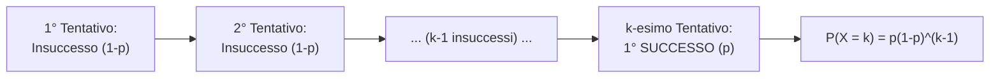

# Lezione 05 - Variabile Aleatoria Geometrica e Proprietà di Mancanza di Memoria

> ⬅️ **Precedente:** [[Lezione 04 - Variabili Aleatorie Discrete, Bernoulli e Binomiale]] | 🏠 **Indice:** [[00 - INDICE STATISTICA]] | **Successiva:** [[Lezione 06 - Variabile Aleatoria di Poisson e Legge dei Casi Rari]] ➡️ | 🛠️ **Pratica:** [[Guida Pratica agli Esercizi d'Esame e Strategie Risolutive]]

---
**Docente:** Vito Onofrio Crismale (`vitoonofrio.crismale@uniba.it`)  
**Testi di riferimento:**
- Ross, *Statistica per l'Ingegneria e le Scienze*
- Baldi, *Calcolo delle Probabilità e Statistica*

---

## 1. Definizione di Variabile Aleatoria Geometrica: $X \sim \text{Geo}(p)$

> [!abstract] L'Idea in Parole Semplici: "Il Tempo di Primo Successo"
> Mentre la distribuzione Binomiale fissa in anticipo il numero di tentativi $n$ e conta quanti successi escono, la distribuzione **Geometrica** ribalta la prospettiva: ripetiamo un esperimento di tipo successo/insuccesso (con probabilità di successo $p$) in modo indipendente **finché non otteniamo il primo successo**, e contiamo **a quale tentativo $k$ è avvenuto il $1^\circ$ successo**.

### Definizione Formale

Una variabile aleatoria $X$ si dice **Geometrica** di parametro $p$ (con $0 < p < 1$), e si scrive $X \sim \text{Geo}(p)$, se:
1. $X$ assume valori interi positivi in $\mathbb{N} \setminus \{0\}$:
   $$\text{cod}(X) = \{1, 2, 3, \dots\} = \mathbb{N} \setminus \{0\}$$
2. La sua funzione di probabilità è data, per ogni $k \in \mathbb{N} \setminus \{0\}$, da:
   $$\boxed{P(X = k) = p(1 - p)^{k - 1} \qquad \forall k \in \mathbb{N} \setminus \{0\}}$$

### Interpretazione Fisica / Fenomenologica
Più in generale, se ho un fenomeno aleatorio di tipo **successo / insuccesso** con $P(\text{successo}) = p$ e lo ripeto in modo **indipendente** finché non ottengo il primo successo, detta $X$ la variabile aleatoria che registra **a quale tentativo è avvenuto il $1^\circ$ successo**, allora:
$$X \sim \text{Geo}(p)$$
Perché la formula è $p(1-p)^{k-1}$?  
Perché l'evento $\{X = k\}$ si verifica se e solo se i primi $k - 1$ tentativi sono stati tutti **insuccessi** (ciascuno con probabilità $1 - p$) e il $k$-esimo tentativo è stato un **successo** (con probabilità $p$). Per l'indipendenza delle prove:
$$P(X = k) = \underbrace{(1-p) \cdot (1-p) \cdots (1-p)}_{k-1 \text{ volte}} \cdot p = p(1-p)^{k-1}$$

---

### Esempio Classico: Lancio di una moneta fino alla prima Testa

**Problema:**  
Lancio una moneta equilibrata finché non ottengo **Testa** per la prima volta.  
Sia $X$ la variabile aleatoria che vale $n$ se ho ottenuto Testa per la prima volta all'$n$-esimo tentativo. Qual è la legge di $X$?

**Soluzione:**
- La probabilità di successo (Testa) nel singolo lancio è $p = \frac{1}{2}$.
- $X$ è una variabile aleatoria **Geometrica** con parametro $p = \frac{1}{2}$, ossia:
  $$X \sim \text{Geo}\left(\frac{1}{2}\right)$$
- Infatti $X$ assume valori in $\mathbb{N} \setminus \{0\} = \{1, 2, 3, \dots\}$ (non esiste un limite massimo fissato a priori al numero di lanci necessari!) e per ogni $n \ge 1$:
  $$\boxed{P(X = n) = \left(1 - \frac{1}{2}\right)^{n-1} \cdot \left(\frac{1}{2}\right) = \left(\frac{1}{2}\right)^{n-1} \left(\frac{1}{2}\right) = \left(\frac{1}{2}\right)^n = \frac{1}{2^n}}$$

---

## 2. Verifica della Normalizzazione ($\sum_{k=1}^{+\infty} P(X = k) = 1$)

Poiché il codominio $\text{cod}(X) = \mathbb{N} \setminus \{0\}$ è **infinito numerabile**, dobbiamo verificare che la somma della serie di tutte le probabilità faccia effettivamente $1$.

### Richiamo sulla Serie Geometrica
Dall'Analisi Matematica ricordiamo che, per ogni numero reale $x$ con $|x| < 1$, la serie geometrica di ragione $x$ converge e vale:
$$\boxed{|x| < 1 \implies \sum_{k=0}^{+\infty} x^k = \frac{1}{1 - x}}$$

### Dimostrazione passo-passo
Calcoliamo la somma delle probabilità per $X \sim \text{Geo}(p)$:
1. Portiamo fuori dalla sommatoria la costante $p$:
   $$\sum_{k=1}^{+\infty} P(X = k) = \sum_{k=1}^{+\infty} p(1 - p)^{k - 1} = p \sum_{k=1}^{+\infty} (1 - p)^{k - 1}$$
2. Effettuiamo il cambio di indice ponendo $j = k - 1$ (quando $k = 1 \implies j = 0$; quando $k \to +\infty \implies j \to +\infty$):
   $$= p \sum_{j=0}^{+\infty} (1 - p)^j$$
3. Poiché $0 < p < 1$, la ragione della serie è $x = 1 - p \in (0, 1)$, quindi $|1 - p| < 1$ e possiamo applicare la formula della serie geometrica:
   $$= p \cdot \frac{1}{1 - (1 - p)} = p \cdot \frac{1}{p} = 1 \quad \blacksquare$$

---

## 3. Probabilità delle Code $P(X > n)$ e Funzione di Ripartizione

Prima di enunciare la proprietà di mancanza di memoria, calcoliamo la probabilità della coda destra $\{X > n\}$, ovvero la probabilità che servano **più di $n$ tentativi** per vedere il primo successo.

### Metodo 1: Interpretazione Logica Immediata
Dire che il primo successo avviene dopo l'$n$-esimo tentativo ($X > n$) equivale esattamente a dire che **i primi $n$ tentativi sono stati tutti insuccessi**. Per l'indipendenza dei tentativi:
$$\boxed{P(X > n) = (1 - p)^n \qquad \forall n \in \mathbb{N} \setminus \{0\}}$$

### Metodo 2: Somma della Serie
Calcolando direttamente tramite la serie:
$$P(X > n) = \sum_{k=n+1}^{+\infty} p(1 - p)^{k - 1} = p(1 - p)^n \sum_{j=0}^{+\infty} (1 - p)^j = p(1 - p)^n \cdot \frac{1}{1 - (1 - p)} = (1 - p)^n$$

### Conseguenza: Funzione di Distribuzione $F_X(n)$ nei punti interi
Passando all'evento complementare $\{X \le n\} = \{X > n\}^c$, otteniamo immediatamente:
$$\boxed{F_X(n) = P(X \le n) = 1 - P(X > n) = 1 - (1 - p)^n \qquad \forall n \in \mathbb{N} \setminus \{0\}}$$

---

## 4. Proprietà di Mancanza di Memoria (Assenza di Memoria)

> [!abstract] Il Concetto Chiave: "Il Fenomeno Non Invecchia"
> Supponiamo di aver già lanciato la moneta $m = 10$ volte e di aver ottenuto $10$ Croci di fila (quindi sappiamo che $X > 10$). Qual è la probabilità di dover aspettare ancora più di $n = 5$ ulteriori lanci prima di vedere Testa (cioè $X > 10 + 5$)?  
> La **Proprietà di Mancanza di Memoria** ci dice che i $10$ fallimenti passati vengono completamente "dimenticati": la probabilità di aspettare altri $n$ tentativi è identica a quella che avevamo all'inizio, $P(X > n)$!

### Enunciato della Proposizione (Mancanza di Memoria)

Sia $X \sim \text{Geo}(p)$. Allora per ogni $n \in \mathbb{N} \setminus \{0\}$ si ha $P(X > n) = (1 - p)^n$, e vale l'identità:
$$\boxed{P(X > n + m \mid X > m) = P(X > n) \qquad \forall n, m \in \mathbb{N} \setminus \{0\}}$$

### Dimostrazione Completa (Svolta a Lezione)

1. Applichiamo la definizione di probabilità condizionata:
   $$P(X > n + m \mid X > m) = \frac{P(X > n + m, \, X > m)}{P(X > m)}$$
2. Osserviamo l'intersezione a numeratore: poiché $n, m \ge 1$, se un numero supera $n + m$ allora supera automaticamente anche $m$. In termini insiemistici:
   $$\{X > n + m\} \subseteq \{X > m\} \implies \{X > n + m\} \cap \{X > m\} = \{X > n + m\}$$
3. Pertanto il rapporto diventa:
   $$P(X > n + m \mid X > m) = \frac{P(X > n + m)}{P(X > m)}$$
4. Sostituiamo la formula delle code $P(X > k) = (1 - p)^k$ al numeratore e al denominatore:
   $$= \frac{(1 - p)^{n + m}}{(1 - p)^m} = \frac{(1 - p)^n \cdot (1 - p)^m}{(1 - p)^m} = (1 - p)^n = P(X > n) \quad \blacksquare$$

> [!important] Unicità della Distribuzione Geometrica
> La distribuzione Geometrica è **l'unica distribuzione discreta** su $\mathbb{N} \setminus \{0\}$ che gode della proprietà di mancanza di memoria! (Nel caso continuo, come vedremo più avanti nel corso, l'analogo continuo sarà la *distribuzione Esponenziale*).

---

## 5. Checkpoint & Trabocchetti d'Esame

> [!danger] Trabocchetto 1: Confondere Binomiale e Geometrica nelle tracce d'esame
> Quando leggi il testo di un esercizio con prove ripetute di tipo successo/insuccesso, chiediti sempre:
> - **Il numero di prove $n$ è fissato a priori** e mi chiede quanti successi escono? $\implies$ **Binomiale** $X \sim b(n, p)$, codominio $\{0, 1, \dots, n\}$.
> - **Si continua a ripetere la prova finché non esce il $1^\circ$ successo** e mi chiede il numero di tentativi necessari? $\implies$ **Geometrica** $X \sim \text{Geo}(p)$, codominio $\{1, 2, 3, \dots\}$ (illimitato!).

> [!danger] Trabocchetto 2: La fallacia dello scommettitore ("I numeri ritardatari del Lotto")
> Se un numero del Lotto non esce da $m = 100$ estrazioni ($X > 100$), la probabilità che non esca nemmeno nelle prossime $n = 10$ estrazioni condizionatamente al fatto che ritarda da 100 turni è:
> $$P(X > 100 + 10 \mid X > 100) = P(X > 10)$$
> Non aumenta affatto la probabilità che esca! Le estrazioni non hanno memoria del passato.

> [!question] La Domanda del Prof all'Orale
> **D:** *"Enuncia e dimostra la proprietà di mancanza di memoria per una variabile aleatoria Geometrica."*  
> **R:** (Scrivi subito la formula $P(X > n+m \mid X > m) = P(X > n)$ per $n, m \in \mathbb{N}\setminus\{0\}$, mostra prima che $P(X > k) = (1-p)^k$ tramite la serie geometrica o l'indipendenza dei $k$ insuccessi, poi usa il fatto che $\{X > n+m\} \cap \{X > m\} = \{X > n+m\}$ e semplifica $\frac{(1-p)^{n+m}}{(1-p)^m} = (1-p)^n$).

---

## 🔗 Link Interni (Mappa del Grafo)

- 🏠 **Indice Generale:** [[00 - INDICE STATISTICA]]
- ⬅️ **Lezione Precedente (Bernoulli e Binomiale):** [[Lezione 04 - Variabili Aleatorie Discrete, Bernoulli e Binomiale]]
- ⬅️ **Prerequisiti (Probabilità Condizionata):** [[Lezione 02 - Probabilità Condizionata, Teorema di Bayes ed Eventi Indipendenti]]
- ➡️ **Lezione Successiva (V.A. di Poisson e Legge dei Casi Rari):** [[Lezione 06 - Variabile Aleatoria di Poisson e Legge dei Casi Rari]]
- 🛠️ **Strategie d'Esame:** [[Guida Pratica agli Esercizi d'Esame e Strategie Risolutive]]
